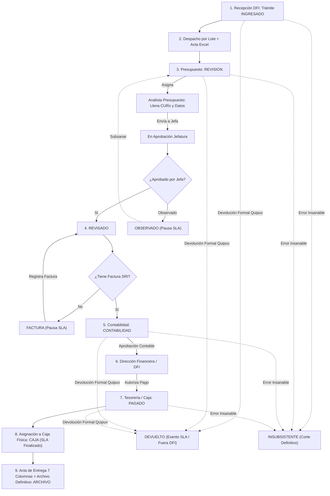

# SENAE Control Previo al Pago - Contexto Operativo y Registro Integral del Proyecto

Este documento consolida la **especificación funcional completa**, las **reglas de negocio oficiales**, la **arquitectura técnica** y el **detalle exhaustivo de todas las funcionalidades, componentes y flujos implementados en el proyecto**, permitiendo continuar el desarrollo en cualquier entorno sin pérdida de contexto.

---

## 1. Identificación y Registro del Entorno

- **Repositorio:** `Rodney-David/senae-previo-al-pago-v2` (`senae_control_previo_v2_rocky9`)
- **Pila Tecnológica:** Next.js 14 (App Router), React 18, TypeScript, Tailwind CSS, Prisma ORM, PostgreSQL / SQLite (según despliegue Rocky Linux o desarrollo local), ExcelJS, Lucide React.
- **Volumen del Código Fuente:** **29,322 líneas de código** distribuidas en **116 archivos** propios (excluyendo dependencias de `node_modules` y compilación `.next`).
- **Historial de Conversación y Traza de Sesión:**
  - Conversation ID actual: `eba9344f-b0a7-408a-95de-1b8fde8081a3`
  - Transcripts locales en IDE:
    - Completo: `<appDataDir>\brain\eba9344f-b0a7-408a-95de-1b8fde8081a3\.system_generated\logs\transcript_full.jsonl`
    - Compacto: `<appDataDir>\brain\eba9344f-b0a7-408a-95de-1b8fde8081a3\.system_generated\logs\transcript.jsonl`

---

## 2. Taxonomía de Gestiones (Jerarquía Padre - Hijo)

El sistema clasifica los expedientes ingresados en 2 grandes categorías padre y sus respectivos tipos hijos dependientes:

### A. TIPO PAGO (Padre)
1. **`PAGO`**: Trámite principal con afectación económica y presupuestaria completa.
2. **`EXPEDIENTE`**: Expediente documental que acompaña o antecede una gestión de pago.
3. **`JUSTIFICACION`**: Trámite de justificación de fondos / anticipos con flujo contable especializado.

### B. TIPO GARANTIA (Padre)
1. `Caución`
2. `Devolución de caución`
3. `Devolución de valores`
4. `Garantia`
5. `Juicio`
6. `Pago indebido`
7. `Proceso coactivo`
8. `Reparación Económica`
9. `Sentencia`

---

## 3. Módulo de Recepción (Secretaría DFI - `/recepcion`)

### A. Reglas de Formulario y Experiencia de Usuario (UI Limpia)
- **Selectores Jerárquicos Dependientes:** Al seleccionar la categoría padre (`PAGO` o `GARANTIA`), el selector de tipo de gestión se actualiza inmediatamente y resetea selecciones inválidas.
- **Eliminación de Sobrecarga Visual:**
  - Se eliminó el cuadro azul de advertencia de política operativa (*"Cero Autoasignación Inicial"*).
  - Los tipos de proceso se muestran limpios sin códigos técnicos internos (ej: *"Servicios básicos"* en lugar de *"Servicios básicos (SERV_BASICOS)"*).
  - La obligatoriedad se indica de manera limpia y estándar únicamente con asterisco `*` o texto `(opcional)`.
  - Eliminación total del parpadeo (*flicker*) al recargar la página mediante hidratación controlada del usuario en sesión (`mounted` check).
  - Redirección dura instantánea (`window.location.href = "/login"`) si la sesión expira en el cliente, limpiando residuos de `localStorage`.

### B. Condicionamiento Dinámico de Campos:
- **`TIPO PAGO - PAGO`**:
  - Número Quipux: **Obligatorio**
  - Fecha del Memorando: **Obligatorio**
  - Fecha de Recepción Física: **Obligatorio**
  - Área Requirente: **Obligatorio**
  - Tipo de Proceso: **Obligatorio**
  - Asunto: **Obligatorio**
  - Razón Social / Proveedor Beneficiario: **Obligatorio**
  - RUC: **Obligatorio**
  - Subtotal: **Obligatorio**
- **`TIPO PAGO - EXPEDIENTE`** y **`TIPO PAGO - JUSTIFICACION`**:
  - Quipux, Fechas, Área, Proceso y Asunto: **Obligatorios**
  - Proveedor, RUC y Subtotal: **Opcionales**
- **Campos Eliminados en Recepción:** Facturas, IVA, retenciones y multas no se solicitan al momento del ingreso en secretaría; se gestionan en las fases de control previo y contabilidad.

---

## 4. Matriz Oficial de Estados del Trámite y Reglas de Fidelidad Histórica

> [!IMPORTANT]
> **Regla de Oro del Proyecto (AGENTS.md):**
> 1. El estado oficial en base de datos e interfaz para el área contable es **`CONTABILIDAD`** (NUNCA usar `CONTROL_PREVIO`).
> 2. Estricta fidelidad al flujo y terminología original de la bitácora del SENAE (`INGRESADO`, `REVISION`, `REVISADO`, `FACTURA`, `CONTABILIDAD`, `DFI`, `PAGADO`, `CAJA`, `ARCHIVO`, `DEVUELTO`, `OBSERVADO`, `INSUBSISTENTE`).

### Catálogo de Estados Oficiales:
1. **`INGRESADO`**: Expediente recién creado por Secretaría en su bandeja *"Mi Escritorio"*. Cero autoasignación; permanece en espera de despacho por lote a Presupuesto.
2. **`REVISION`**: Expediente entregado formalmente y recibido físicamente en Presupuesto (en manos de la Jefa de Presupuesto o asignado a un analista para control previo y completado de datos). Inicia el cómputo del SLA.
3. **`REVISADO`**: Trámite revisado con visto bueno técnico otorgado por la Jefatura de Presupuesto.
4. **`FACTURA`**: Trámite con revisión presupuestaria completa que queda a la espera de factura electrónica SRI. **Pausa formalmente el cómputo de SLA / semáforo**.
5. **`CONTABILIDAD`**: Trámite derivado al área contable (en manos del Contador General o asignado a un analista contable para CUR Devengado y retenciones).
6. **`DFI`**: Trámite aprobado por Contabilidad, en custodia de la Dirección Financiera / Tesorería para autorización y pago.
7. **`PAGADO`**: Pago ejecutado y verificado en Tesorería / Administración de Caja (con referencia SPI-BCE y fecha de pago efectivo).
8. **`CAJA`**: Trámite pagado que ha sido asignado e ingresado a una caja física de cartón en Tesorería. Detiene el SLA con estado `FINALIZADO`.
9. **`ARCHIVO`**: Custodia física final en el Archivo Pasivo Central (**Cierre formal del ciclo** mediante archivo en bloque de cajas).
10. **`OBSERVADO` / `OBSERVADO_72H`**: **Estado transversal** aplicable en cualquier momento ante novedades con terceros (administradores de contrato). **Pausa el SLA** y exige motivo obligatorio.
11. **`DEVUELTO` / `DEVUELTO_FORMALMENTE`**: Expediente devuelto formalmente a la unidad requirente externa mediante memorando oficial Quipux por faltante de soportes o nulidad insubsanable fuera de la DFI. **Exento de cómputo de SLA**, excluido de las bandejas operativas activas de Mi Escritorio y catalogado en la consulta general de Trámites.
12. **`INSUBSISTENTE`**: **Estado terminal** por nulidad absoluta o error insubsanable. Corta el ciclo permanentemente con justificación obligatoria inmutable.

---

## 5. Control de Tiempos y Semáforo Operativo (SLA)

- **Tiempo Límite Normativo:** **6 días hábiles** institucionales (`src/lib/slaCalculator.ts`).
- **Descuento de No Laborables:** Omite automáticamente sábados, domingos y el catálogo de feriados nacionales ecuatorianos (`feriados_nacionales`).
- **Pausa Operativa Formal:**
  - Se pausa y congela el contador en estado `FACTURA` y en estados observados (`OBSERVADO`, `OBSERVADO_72H` o `esta_pausado = true`).
  - Acumula los días de pausa legítima en `dias_pausa_acumulados`.
- **Exenciones:** Trámites en estado `INSUBSISTENTE` o `DEVUELTO` (`es_devuelto = true`) quedan explícitamente marcados como **EXENTOS** de cómputo.
- **Detención Final:** Al pasar a `CAJA` o `PAGADO`, el SLA se consolida como `FINALIZADO`, congelando los días a la fecha exacta del pago.
- **Visualización Limpia:** Formato conciso en tabla (`1d`, `2d`, `3d`...) sin leyendas saturadas `/6d`.

---

## 6. Despacho por Lote a Control Previo y Acta de Entrega Excel Oficial

1. **Selección múltiple:** En *"Mi Escritorio"*, la secretaria selecciona $N$ trámites en estado `INGRESADO`.
2. **Acción "Entregar a Control Previo":**
   - El sistema genera y descarga automáticamente un documento Excel formateado para impresión oficial (`ExcelJS`).
   - **Encabezado unificado:** `DOCUMENTO ENTREGADOS A CONTROL PREVIO / RECIBIDO [DD-MM-AA]`
   - **Columnas oficiales:**
     1. `Nro`
     2. `TIPO GESTION` (ej: `PAGO - PAGO`, `PAGO - EXPEDIENTE`)
     3. `AREA`
     4. `Documento / Quipux`
     5. `FECHA MEMORANDO`
     6. `FECHA RECEPCION`
     7. `ASUNTO`
     8. `RECIBE` (columna en blanco para firma física manuscrita)
     9. `FECHA RECIBIDO` (columna en blanco para fecha física)
   - Transición atómica de estados: los trámites seleccionados pasan de `INGRESADO` a `REVISION`.
   - Custodio reasignado automáticamente a la **Jefa de Presupuesto**.
3. **Recepción Física en Presupuesto:**
   - La Jefatura o Analistas de Presupuesto cuentan con el botón **«Recibir Físicamente»** en su escritorio para confirmar que los expedientes en papel ya llegaron al área, pasando a revisión activa e iniciando el cómputo de SLA.

---

## 7. Ficha del Trámite (`/tramite/[id]`): Estructura, Títulos y Acordeón Inteligente

La ficha de detalle del expediente cuenta con una arquitectura de tarjetas modulares adaptativas con colapso condicional según el perfil del usuario activo:

### A. Títulos Oficiales de las Secciones:
1. **`DATOS GENERALES DEL TRÁMITE`** (`TarjetaDatosGenerales.tsx`)
2. **`DOCUMENTOS Y REFERENCIAS`** (`TablaReferencias.tsx`)
3. **`CONTROL PREVIO - PRESUPUESTO`** (`TarjetaPresupuesto.tsx`)
4. **`CONTABILIDAD`** (`TarjetaContabilidad.tsx`)
5. **`ADMINISTRACION DE CAJA`** (`TarjetaTesoreria.tsx`)
6. **`CUSTODIA, ARCHIVO Y CIERRE DEL EXPENDIENTE`** (`TarjetaArchivo.tsx`)
7. **`BITACORA HISTORICA - AUDITORIA`** (`TimelineBitacora.tsx`)

### B. Lógica de Secciones Plegables / Acordeón por Rol:
- **`DATOS GENERALES DEL TRÁMITE`**: **NUNCA PLEGABLE**. Permanece siempre abierto y visible para todos los usuarios sin importar su rol.
- **Roles con Todo Desplegado por Defecto:** `DIRECTORA`, `SECRETARIA`, `ADMIN`.
- **Roles Operativos Específicos:** Todo plegado (cerrado) por defecto, **excepto la sección de su respectiva competencia**:
  - **Presupuesto** (`id_area === 2`): Se abre automáticamente solo `CONTROL PREVIO - PRESUPUESTO`.
  - **Contabilidad** (`id_area === 3`): Se abre automáticamente solo `CONTABILIDAD`.
  - **Tesorería / Caja** (`id_area === 4`): Se abre automáticamente solo `ADMINISTRACION DE CAJA`.
  - **Archivo** (`id_area === 6`): Se abre automáticamente solo `CUSTODIA, ARCHIVO Y CIERRE DEL EXPENDIENTE`.
- **Interacción Manual:** Todos los encabezados son interactivos y permiten al usuario abrir o cerrar cualquier sección a demanda, con chevron animado y protección contra eventos burbuja (`stopPropagation`).

### C. Dinamismo en Presupuesto y Contabilidad:
- **`TarjetaPresupuesto.tsx`**:
  - `CUR Compromiso`: Filas individuales dinámicas con botón `[+ Agregar]` y papelera para eliminar, almacenadas de forma transparente como lista separada por comas.
  - `Factura`: Filas individuales dinámicas con botón `[+ Agregar]` y papelera para eliminar.
  - Regla de validación: La factura es opcional mientras se prepara el trámite o se remite a Jefatura para visto bueno; sin embargo, **es estrictamente obligatoria para derivar el trámite a Contabilidad**. Si no hay factura, el trámite pasa al estado `FACTURA` (pausa de SLA).
- **`TarjetaContabilidad.tsx`**:
  - `CUR DEV` (CUR Devengado) y `CUR CON` (CUR Contable): Dinámicos con botón `[+ Agregar]` y papelera. Ambos 100% opcionales.
  - Se eliminaron los campos obsoletos *«Nro. Liquidación»* y *«Nro. Juicio»*.

### D. Módulo de Administración de Caja (Tesorería):
- Se eliminaron los campos obsoletos *Lote eSIGEF* y *Comprobante de Pago*.
- La sección cuenta con:
  1. **`Referencia SPI Banco Central`** (Opcional).
  2. **`Fecha Autorización de Pago`**.
  3. **`Fecha Pago Efectivo`**.
  4. **`Número de Hojas`** (`numero_hojas` / fojas físicas).

---

## 8. Flujo Operativo Completo Paso a Paso



---

## 9. Submódulo de Referencias Quipux

- Cada trámite permite adjuntar múltiples documentos o referencias complementarias (oficios, memorandos, informes técnicos).
- Componente `TablaReferencias.tsx`: Permite visualizar Nro. Quipux, fecha, remitente, asunto y tipo de referencia, con creación directa y persistencia en `tramite_referencias`.

---

## 10. Matriz Institucional de Permisos CRUD

| Rol / Área Institucional | Crear Trámite | Ver / Consultar | Modificar Datos Generales | Acciones Propias de Fase | Anular / Eliminar Trámite |
| :--- | :---: | :---: | :---: | :---: | :---: |
| **Administrador del Sistema (`ADMIN`)** | ✅ Sí (`/recepcion`) | ✅ Sí (Todos) | ✅ Sí (`TarjetaDatosGenerales`) | ✅ Sí (Todas) | ✅ Sí (`DELETE /api/tramites/[id]`) |
| **DFI - Directora Financiera (`DIRECTORA`, `id_area: 1`)** | ✅ Sí (`/recepcion`) | ✅ Sí (Todos) | ✅ Sí (`TarjetaDatosGenerales`) | ✅ Sí (Aprobación DFI) | ✅ Sí (`DELETE /api/tramites/[id]`) |
| **DFI - Secretaría (`SECRETARIA`, `id_area: 1`)** | ✅ Sí (`/recepcion`) | ✅ Sí (Todos) | ✅ Sí (`TarjetaDatosGenerales`) | ✅ Sí (Despacho / Acta) | ✅ Sí (`DELETE /api/tramites/[id]`) |
| **Presupuesto - Jefatura (`JEFE`, `id_area: 2`)** | ❌ No | ✅ Sí (Todos) | ✅ Sí (`TarjetaDatosGenerales`) | ✅ Sí (Visto Bueno REVISADO) | ❌ No |
| **Presupuesto - Analistas (`ANALISTA`, `id_area: 2`)** | ❌ No | ✅ Sí (Todos) | ✅ Sí (`TarjetaDatosGenerales`) | ✅ Sí (Llenado Control Previo) | ❌ No |
| **Contabilidad (`id_area: 3`)** | ❌ No | ✅ Sí (Todos) | ❌ No (Solo Lectura) | ✅ Sí (Fase Contable) | ❌ No |
| **Tesorería / Caja (`id_area: 4`)** | ❌ No | ✅ Sí (Todos) | ❌ No (Solo Lectura) | ✅ Sí (Pago MEF / BCE) | ❌ No |
| **Custodia y Archivo (`id_area: 6`)** | ❌ No | ✅ Sí (Todos) | ❌ No (Solo Lectura) | ✅ Sí (Cajas / Archivo) | ❌ No |

---

## 11. Bandejas de «Mi Escritorio» (`/escritorio`): Aislamiento y Exclusión de Inactivos

La bandeja de *Mi Escritorio* es estrictamente transaccional y personal/departamental (lo que está en custodia o asignación del funcionario en ese instante). Se organiza en pestañas contextuales:

1. **«En Mi Escritorio»**: Únicamente los trámites bajo custodia física directa del usuario activo (`id_custodio_actual = currentUser.id_usuario`).
2. **«Reasignados»**: Trámites dentro de la misma área que están en manos de otros compañeros de equipo.
3. **«Todos del Área»**: Totalidad de los expedientes activos pertenecientes al departamento (`id_area_actual = userArea`).
   - **Regla Estricta de Purga de Inactivos:** Excluye forzosamente trámites en `ARCHIVO`, `FINALIZADO_ARCHIVADO`, `ANULADO`, `DEVUELTO`, `DEVUELTO_FORMALMENTE` y aquellos con la bandera `es_devuelto = true`.
4. **«En Aprobación»**: Exclusivo para Jefaturas de Presupuesto, Contabilidad y Directora; expedientes enviados para visto bueno o revisión formal.
5. **«Observados»**: Trámites con observaciones activas o en pausa de 72 horas.
6. **«Por Entregar (Ingresados)»**: Exclusivo para DFI/Secretaría; expedientes recién ingresados listos para generar el Acta Excel de entrega.
7. **«En Caja»**: Exclusivo para Tesorería/Archivo; expedientes pagados en proceso de empaque físico en cartones.

---

## 12. Catálogo General de Trámites (`/tramites`): Filtro de Fechas y Búsqueda Global

El módulo de consulta consolidada (`/tramites`) permite auditar la totalidad de expedientes del SENAE mediante una barra de filtros avanzada:

1. **Filtro de Fechas (Rango y Criterio Dinámico):**
   - **Selector de Criterio:** Permite filtrar por:
     - `Ingreso / Radicación` (fecha de entrada a DFI/Ventanilla).
     - `Memorando Quipux` (fecha de emisión del memorando requirente).
     - `Último Movimiento` (fecha de la última transición de estado o traspaso).
   - **Rango de Fechas:** Campos `Desde` y `Hasta` con botón rápido `✕` para limpiar el rango.
2. **Filtros Institucionales:** Selectores rápidos de **Áreas**, **Funcionarios** y **Estados**.
3. **Búsqueda Global en Tiempo Real:** Evalúa en simultáneo 8 campos clave: Número Quipux, Código de Trámite, Gestión, Proveedor Beneficiario, RUC, Tipo de Proceso, Funcionario Custodio, Estado y Número de Factura.
4. **Visualización en Tabla:** Muestra la fecha de ingreso debajo del código Quipux para confirmación inmediata del rango filtrado.
5. **Control de Acciones:** La columna de eliminación (tacho de basura) se oculta automáticamente para todos los roles que no sean `ADMIN`, `DIRECTORA` o `SECRETARIA`.

---

## 13. Módulo de Cajas, Control Físico y Archivo (`/cajas`)

1. **Permanencia en Caja:** Tras ejecutarse el pago (`PAGADO`), el expediente físico no va directo al archivo pasivo; permanece en Tesorería (`id_area_actual = 4`) para ser agrupado en una caja de cartón.
2. **Llenado Concurrente:** El personal puede crear y alimentar múltiples cajas abiertas en paralelo (`cajas` model).
3. **Estado Operativo `CAJA`:** Al empacar el trámite, pasa a `estado_general = "CAJA"` y el SLA se detiene como `FINALIZADO`.
4. **Documento Oficial de 7 Columnas:** Antes del archivo, se genera el reporte oficial en Excel (`GET /api/cajas/[id]/exportar`) y vista previa para impresión directa (`window.print()`):
   - `No. Cartón`, `No. CUR`, `No. Hojas`, `Proveedor y Asunto`, `Valor`, `Fecha y Observaciones`, `Fecha envió de correos`.
5. **Archivo en Bloque:** Al presionar «Cerrar Caja y Archivar», el endpoint atómico [POST /api/cajas/[id]/archivar](file:///c:/Users/PC/Documents/RODNEY%20SENAE/senae_control_previo_v2_rocky9/src/app/api/cajas/%5Bid%5D/archivar/route.ts) transiciona la caja a `ARCHIVADA`, todos sus trámites a `ARCHIVO` y transfiere la custodia física formal al Archivo Central (`id_area_actual = 6`).

---

## 14. Módulo de Reportería e Indicadores (`/reportes`)

Estructurado en dos reportes analíticos con exportación a Excel multihioja (`ExcelJS`):
- **Reporte 1: Trámites Ingresados y Custodia Actual:** KPIs globales, tabla jerárquica de custodia por funcionario con semáforos SLA (En Plazo, En Riesgo, Vencido), distribución porcentual por departamentos y listado detallado con enlaces al expediente.
- **Reporte 2: Datos Estadísticos de Tardanza y Cuellos de Botella:** Desglose cronológico exacto calculado desde la bitácora inmutable de `historial_movimientos` a través de las 4 fases institucionales (DFI, Presupuesto, Contabilidad y Tesorería), ranking de causas de retraso (espera de factura SRI, observaciones 72h, asientos contables complejos) y matriz de tardanza por tipología de proceso.

---

## 15. Autenticación, Seguridad y Gestión de Sesión

1. **Seguridad Institucional GovTech:**
   - Desafío Captcha visual dinámico mediante SVG generado en backend (`/api/auth/captcha`).
   - Token criptográfico de sesión firmado con HMAC-SHA256 (`src/lib/session.ts`) almacenado en cookie segura HttpOnly `senae_session`.
   - Vigencia estricta de 2 horas de sesión (`DEFAULT_SESSION_DURATION_MS`) y temporizador de inactividad de 30 minutos sin interacción.
2. **Blindaje Anti-Anidación de Layouts (Resolución Definitiva de Bug de Login):**
   - **Navegación Dura Forzada:** Ante logout por inactividad o expiración de token, se ejecuta forzosamente `window.location.href = "/login?expired=1"` junto con `localStorage.removeItem("senae_user_session")`, destruyendo por completo el cascarón de React y evitando que el formulario de login quede incrustado dentro de `AppLayout`.
   - **Detección Proactiva al Reenfocar:** Escuchadores de `focus` y `visibilitychange` verifican la validez de la sesión en el milisegundo en que el usuario regresa a la pestaña.
   - **Auto-Escape en `LoginPage`:** Si el componente de login se monta dentro del `<header>` del dashboard o en una URL distinta a `/login`, se auto-recarga inmediatamente a pantalla completa.
   - **Cabeceras Anti-Caché:** `Cache-Control: no-store, no-cache, must-revalidate` en middleware.

---

## 16. Ingesta y Migración de Datos Históricos (Bitácora 2026)

- **Motor de Migración:** [src/services/migracionExcelService.ts](file:///c:/Users/PC/Documents/RODNEY%20SENAE/senae_control_previo_v2_rocky9/src/services/migracionExcelService.ts) y [scripts/re_migrar_oficial.ts](file:///c:/Users/PC/Documents/RODNEY%20SENAE/senae_control_previo_v2_rocky9/scripts/re_migrar_oficial.ts).
- **Procesamiento de Datos Reales:** Más de 1,500 trámites migrados con normalización de números Quipux (`SENAE-DPP-2026-XXXX-M`), limpieza de RUCs, categorización padre-hijo, resolución de montos y cálculo de historial cronológico.
- **Funcionarios Oficiales:** Mapeo automático de custodios reales del SENAE con sus nombres, cargos, iniciales y áreas institucionales ([scripts/configurar_usuarios_oficiales.ts](file:///c:/Users/PC/Documents/RODNEY%20SENAE/senae_control_previo_v2_rocky9/scripts/configurar_usuarios_oficiales.ts)).

---

## 17. Guía Rápida de Comandos de Ejecución

```bash
# 1. Instalar dependencias
npm install

# 2. Sincronizar Prisma ORM
npx prisma generate
npx prisma db push

# 3. Migración oficial de datos históricos
npx tsx scripts/configurar_usuarios_oficiales.ts
npx tsx scripts/re_migrar_oficial.ts

# 4. Chequeo estricto de tipos de TypeScript
npx tsc --noEmit

# 5. Iniciar servidor de desarrollo
npm run dev
```

---

*Documento consolidado, exhaustivo y verificado conforme al estado real de desarrollo, código fuente y reglas operativas del sistema SENAE Control Previo al Pago v2.0.*
