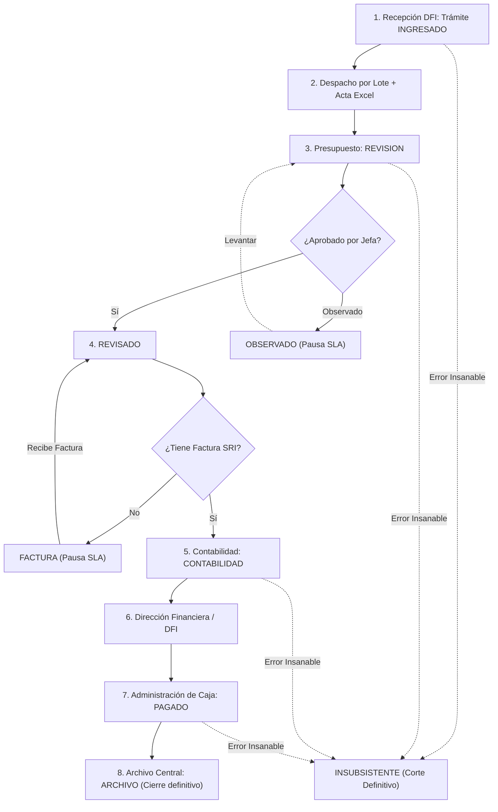

# SENAE Control Previo al Pago - Contexto Operativo y Registro Integral del Proyecto

Este documento consolida la **especificación funcional completa**, las **reglas de negocio oficiales**, la **arquitectura técnica** y el **detalle exhaustivo de todas las funcionalidades y componentes implementados hasta la fecha**, permitiendo continuar el desarrollo en cualquier entorno sin pérdida de contexto.

---

## 1. Identificación y Registro del Entorno

- **Repositorio:** `senae_control_previo_v2_rocky9`
- **Pila Tecnológica:** Next.js 14 (App Router), React 18, TypeScript, Tailwind CSS, Prisma ORM, SQLite / PostgreSQL (según despliegue), ExcelJS, Lucide React.
- **Historial de Conversación y Traza de Sesión:**
  - Conversation ID actual: `cb7485fd-9940-42c5-9e56-e7b9090359a6`
  - Transcripts locales en IDE:
    - Completo: `<appDataDir>\brain\cb7485fd-9940-42c5-9e56-e7b9090359a6\.system_generated\logs\transcript_full.jsonl`
    - Compacto: `<appDataDir>\brain\cb7485fd-9940-42c5-9e56-e7b9090359a6\.system_generated\logs\transcript.jsonl`

---

## 2. Taxonomía de Gestiones (Jerarquía Padre - Hijo)

El sistema clasifica los expedientes ingresados en 2 grandes categorías padre y sus respectivos tipos hijos dependientes:

### A. TIPO PAGO (Padre)
1. **`PAGO`**: Trámite principal con afectación económica y presupuestaria completa.
2. **`EXPEDIENTE`**: Expediente documental que acompaña o antecede una gestión de pago.
3. **`JUSTIFICACION`**: Trámite de justificación de fondos / anticipos con flujo contable especializado.

### B. TIPO GARANTIA (Padre)
1. `Caución`
2. `Devolución de caución`
3. `Devolución de valores`
4. `Garantia`
5. `Juicio`
6. `Pago indebido`
7. `Proceso coactivo`
8. `Reparación Económica`
9. `Sentencia`

---

## 3. Módulo de Recepción (Secretaría DFI - `/recepcion`)

### A. Reglas de Formulario y Experiencia de Usuario (UI Limpia)
- **Selectores Jerárquicos Dependientes:** Al seleccionar la categoría padre (`PAGO` o `GARANTIA`), el selector de tipo de gestión se actualiza inmediatamente y resetea selecciones inválidas.
- **Eliminación de Sobrecarga Visual:**
  - Se eliminó el cuadro azul de advertencia de política operativa (*"Cero Autoasignación Inicial"*).
  - Los tipos de proceso se muestran limpios sin códigos técnicos internos (ej: *"Servicios básicos"* en lugar de *"Servicios básicos (SERV_BASICOS)"*).
  - Se eliminó la etiqueta pesada *"obligatorio para PAGO - PAGO"*; la obligatoriedad se indica de manera limpia y estándar únicamente con asterisco `*` o texto `(opcional)`.
  - Se eliminó el parpadeo (*flicker*) al recargar la página mediante hidratación controlada del usuario en sesión (`mounted` check).

### B. Condicionamiento Dinámico de Campos:
- **`TIPO PAGO - PAGO`**:
  - Número Quipux: **Obligatorio**
  - Fecha del Memorando: **Obligatorio**
  - Fecha de Recepción Física: **Obligatorio**
  - Área Requirente: **Obligatorio**
  - Tipo de Proceso: **Obligatorio**
  - Asunto: **Obligatorio**
  - Razón Social / Proveedor Beneficiario: **Obligatorio**
  - RUC: **Obligatorio**
  - Subtotal: **Obligatorio**
- **`TIPO PAGO - EXPEDIENTE`** y **`TIPO PAGO - JUSTIFICACION`**:
  - Quipux, Fechas, Área, Proceso y Asunto: **Obligatorios**
  - Proveedor, RUC y Subtotal: **Opcionales**
- **Campos Eliminados en Recepción:** Facturas, IVA, retenciones y multas no se solicitan al momento del ingreso en secretaría; se gestionan en las fases de control previo y contabilidad.

---

## 4. Matriz Oficial de Estados del Trámite (12 Estados)

1. **`INGRESADO`**: Expediente recién creado por Secretaría en su bandeja *"Mi Escritorio"*. Cero autoasignación; permanece en espera de despacho por lote.
2. **`REVISION`**: Expediente entregado formalmente y recibido físicamente en Presupuesto (en manos de la Jefa de Presupuesto o asignado a un analista para control previo y completado de datos).
3. **`REVISADO`**: Trámite revisado con visto bueno técnico otorgado por la Jefatura de Presupuesto.
4. **`FACTURA`**: Trámite con revisión presupuestaria completa que queda a la espera de factura electrónica SRI. **Pausa el cómputo de SLA / semáforo**.
5. **`CONTABILIDAD`**: Trámite derivado al área contable (en manos del Contador General o asignado a un analista contable).
6. **`DFI`**: Trámite aprobado por Contabilidad, en custodia de la Dirección Financiera / Tesorería para autorización y pago.
7. **`PAGADO`**: Pago ejecutado y verificado en Tesorería / Administración de Caja (con referencia SPI-BCE y comprobante de pago).
8. **`ARCHIVO`**: Custodia física final en estantería, tomo o caja del archivo central (**Cierre formal del ciclo**).
9. **`OBSERVADO`**: **Estado transversal** aplicable en cualquier momento ante novedades con terceros (administradores de contrato). **Pausa el SLA** y exige motivo obligatorio.
10. **`INSUBSISTENTE`**: **Estado terminal** por nulidad absoluta o error insubsanable. Corta el ciclo permanentemente con justificación obligatoria inmutable.
11. **`PRESUPUESTO`**: Estado complementario para circuitos presupuestarios específicos.
12. **`JUSTIFICACION_CONTABILIDAD`**: Reservado para flujos específicos de justificación de fondos.

---

## 5. Control de Tiempos y Semáforo Operativo (SLA)

- **Optimización de Visualización en Tablas:**
  - Se eliminó el texto redundante `/6d` y las leyendas saturadas.
  - La visualización del tiempo transcurrido ahora muestra un formato limpio y directo: `1d`, `2d`, `3d`, etc.
  - Para trámites pausados (`FACTURA` u `OBSERVADO`), la celda refleja el estado de pausa operativa claramente sin contadores distorsionados.

---

## 6. Despacho por Lote a Control Previo y Acta de Entrega Excel Oficial

1. **Selección múltiple:** En *"Mi Escritorio"*, la secretaria selecciona $N$ trámites en estado `INGRESADO`.
2. **Acción "Entregar a Control Previo":**
   - El sistema genera y descarga automáticamente un documento Excel formateado para impresión oficial.
   - **Encabezado unificado:** `DOCUMENTO ENTREGADOS A CONTROL PREVIO / RECIBIDO [DD-MM-AA]`
   - **Columnas oficiales:**
     1. `Nro`
     2. `TIPO GESTION` (ej: `PAGO - PAGO`, `PAGO - EXPEDIENTE`)
     3. `AREA`
     4. `Documento / Quipux`
     5. `FECHA MEMORANDO`
     6. `FECHA RECEPCION`
     7. `ASUNTO`
     8. `RECIBE` (columna en blanco para firma física manuscrita)
     9. `FECHA RECIBIDO` (columna en blanco para fecha física)
   - Transición atómica de estados: los trámites seleccionados pasan de `INGRESADO` a `REVISION`.
   - Custodio reasignado automáticamente a la **Jefa de Presupuesto**.

---

## 7. Ficha del Trámite (`/tramite/[id]`): Estructura, Títulos y Acordeón Inteligente

La ficha de detalle del expediente cuenta con una arquitectura de tarjetas modulares adaptativas con colapso condicional según el perfil del usuario activo:

### A. Títulos Oficiales de las Secciones:
1. **`DATOS GENERALES DEL TRÁMITE`** (`TarjetaDatosGenerales.tsx`)
2. **`DOCUMENTOS Y REFERENCIAS`** (`TablaReferencias.tsx`)
3. **`CONTROL PREVIO - PRESUPUESTO`** (`TarjetaPresupuesto.tsx`)
4. **`CONTABILIDAD`** (`TarjetaContabilidad.tsx`)
5. **`ADMINISTRACION DE CAJA`** (`TarjetaTesoreria.tsx`)
6. **`CUSTODIA, ARCHIVO Y CIERRE DEL EXPENDIENTE`** (`TarjetaArchivo.tsx`)
7. **`BITACORA HISTORICA - AUDITORIA`** (`TimelineBitacora.tsx`)

### B. Lógica de Secciones Plegables / Acordeón por Rol:
- **`DATOS GENERALES DEL TRÁMITE`**: **NUNCA PLEGABLE**. Permanece siempre abierto y visible para todos los usuarios sin importar su rol.
- **Roles con Todo Desplegado por Defecto:**
  - `DIRECTORA` (Dirección Financiera)
  - `SECRETARIA` (Secretaría DFI)
  - `ADMIN` (Administrador del Sistema)
- **Roles Operativos Específicos:** Todo plegado (cerrado) por defecto, **excepto la sección de su respectiva competencia**:
  - **Presupuesto** (`id_area === 2`): Se abre automáticamente solo `CONTROL PREVIO - PRESUPUESTO`.
  - **Contabilidad** (`id_area === 3`): Se abre automáticamente solo `CONTABILIDAD`.
  - **Tesorería / Caja** (`id_area === 4`): Se abre automáticamente solo `ADMINISTRACION DE CAJA`.
  - **Archivo** (`id_area === 6`): Se abre automáticamente solo `CUSTODIA, ARCHIVO Y CIERRE DEL EXPENDIENTE`.
  - **Bitácora**: Cerrada por defecto para operativos y abierta para Directora, Secretaria y Admin.
- **Interacción Manual:** Todos los encabezados son interactivos y permiten al usuario abrir o cerrar cualquier sección a demanda, con un chevron animado (`ChevronDown`). Los clics en botones de acción dentro del encabezado tienen `stopPropagation` para no disparar el colapso involuntario.

### C. Módulo de Administración de Caja (Tesorería):
- Se incorporó el campo **Fecha de Autorización de Pago** (`fecha_autorizacion_pago`):
  - Visible en la tarjeta de datos.
  - Editable en el formulario de registro de pago de Tesorería.
  - Persistido a través del endpoint `/api/tramites/[id]/flujo` (acción `PROGRAMAR_Y_PAGAR_MEF_BCE`).

---

## 8. Flujo Operativo Completo Paso a Paso



### Detalle de Fases:
1. **Ingreso en Secretaría:** Creación del expediente sin autoasignación en estado `INGRESADO`.
2. **Entrega a Control Previo:** Generación de acta de entrega en Excel y pase a `REVISION`.
3. **Control Previo (Presupuesto):** Registro de Nro. Trámite, Certificación, Ítem, CUR Compromiso, Período de Pago y hasta 10 anexos.
4. **Visto Bueno "REVISADO" y Reasignación Inteligente:**
   - La Jefa de Presupuesto aprueba a `REVISADO`.
   - Si el analista que preparó el trámite está **Activo y Disponible**, se le reasigna automáticamente.
   - Si está de **Vacaciones/Licencia o Inactivo**, se presenta un selector para que la Jefa elija otro funcionario de su área.
5. **Control de Factura:** Si no hay factura pasa a `FACTURA` (SLA pausado). Al ingresar la factura regresa a `REVISADO` y se habilita la derivación a Contabilidad.
6. **Contabilidad:** El Contador General o su equipo registran CUR Devengado, comprobantes contables y retenciones, aprobando formalmente el pase a `DFI`.
7. **Dirección Financiera y Administración de Caja:**
   - DFI aprueba y despacha a Tesorería.
   - Tesorería registra Fecha de Autorización de Pago, referencia SPI-BCE y comprobante de pago, derivando a `PAGADO`.
8. **Custodia y Archivo Central:** El archivero verifica fojas físicas, tomo/caja, estantería y ubicación física general, consolidando el estado final `ARCHIVO`.

---

## 9. Submódulo de Referencias Quipux

- Cada trámite permite adjuntar múltiples documentos o referencias complementarias (oficios, memorandos, informes).
- Componente `TablaReferencias.tsx`:
  - Permite visualizar Nro. Quipux, fecha, remitente, asunto y tipo de referencia.
  - Permite agregar nuevas referencias directamente desde la ficha del trámite.
  - Totalmente integrado con el sistema de acordeón condicional por rol.

---

## 10. Mantenimiento y Comandos de Ejecución

Para iniciar o validar el proyecto en cualquier estación de trabajo:

```bash
# 1. Instalar dependencias
npm install

# 2. Sincronizar Prisma ORM
npx prisma generate
npx prisma db push

# 3. Poblar datos iniciales (opcional)
npm run seed

# 4. Chequeo estricto de tipos de TypeScript
npx tsc --noEmit

# 5. Compilación de producción
npm run build

# 6. Servidor de desarrollo
npm run dev
```

---
## 11. Ajustes y Optimización de Vistas de Tablas (Escritorio y Control Maestro)

- **Encabezado `GESTIÓN`:** Se simplificó el encabezado de `GESTIÓN (PADRE - HIJO)` a únicamente `GESTIÓN`, manteniendo la visualización jerárquica estilizada en la celda.
- **Eliminación de Columna `ÁREA / CUSTODIO`:** Removida de todas las vistas de tablas (`/escritorio` y `/tramites`) para optimizar el ancho visual y evitar redundancia.
- **Eliminación y Condicionamiento de Columna `ACCIONES`:**
  - En la vista de escritorio (`/escritorio`), la columna `ACCIONES` fue eliminada por completo; la navegación al expediente se realiza directamente mediante **doble clic** (`onDoubleClick`) sobre cualquier fila.
  - En el catálogo general (`/tramites`), la columna `ACCIONES` (que aloja el botón de anular/eliminar trámite con el icono del tacho) **se oculta por completo** (`canAnular = false`) para todos los roles que no tienen permiso de eliminación (Presupuesto, Contabilidad, Tesorería, Archivo, etc.). No se muestra ni cabecera ni celda vacía. Únicamente se renderiza para roles autorizados (`ADMIN`, `DIRECTORA`, `SECRETARIA`).
- **Visualización Limpia de Montos (Sin Badges `≥ $10K`):** Se eliminaron las etiquetas o badges de cuantía (`≥ $10K`) en las celdas de monto/subtotal, mostrando únicamente el valor monetario formateado limpio.
- **Cabecera Simplificada en Ficha del Expediente (`/tramite/[id]`):** Se eliminó la información redundante de *Beneficiario* y *Neto a Pagar* del encabezado superior, manteniendo únicamente el **Código de trámite**, el **Número Quipux** y los **Estados oficiales / SLA**. Toda la información económica y del proveedor se mantiene estructurada en la tarjeta de *Datos Generales del Trámite*.

---

## 12. Matriz Institucional de Permisos CRUD sobre Trámites y Datos Generales

| Rol / Área Institucional | Crear Trámite | Ver / Consultar | Modificar Datos Generales | Acciones Propias de Fase | Anular / Eliminar Trámite |
| :--- | :---: | :---: | :---: | :---: | :---: |
| **Administrador del Sistema (`ADMIN`)** | ✅ Sí (`/recepcion`) | ✅ Sí (Todos) | ✅ Sí (`TarjetaDatosGenerales`) | ✅ Sí (Todas) | ✅ Sí (`DELETE /api/tramites/[id]`) |
| **DFI - Directora Financiera (`DIRECTORA`, `id_area: 1`)** | ✅ Sí (`/recepcion`) | ✅ Sí (Todos) | ✅ Sí (`TarjetaDatosGenerales`) | ✅ Sí (Aprobación DFI) | ✅ Sí (`DELETE /api/tramites/[id]`) |
| **DFI - Secretaría (`SECRETARIA`, `id_area: 1`)** | ✅ Sí (`/recepcion`) | ✅ Sí (Todos) | ✅ Sí (`TarjetaDatosGenerales`) | ✅ Sí (Despacho / Acta) | ✅ Sí (`DELETE /api/tramites/[id]`) |
| **Presupuesto - Jefatura (`JEFE`, `id_area: 2`)** | ❌ No | ✅ Sí (Todos) | ✅ Sí (`TarjetaDatosGenerales`) | ✅ Sí (Visto Bueno REVISADO) | ❌ No |
| **Presupuesto - Analistas (`ANALISTA`, `id_area: 2`)** | ❌ No | ✅ Sí (Todos) | ✅ Sí (`TarjetaDatosGenerales`) | ✅ Sí (Llenado Control Previo) | ❌ No |
| **Contabilidad (`id_area: 3`)** | ❌ No | ✅ Sí (Todos) | ❌ No (Solo Lectura) | ✅ Sí (Fase Contable) | ❌ No |
| **Tesorería / Caja (`id_area: 4`)** | ❌ No | ✅ Sí (Todos) | ❌ No (Solo Lectura) | ✅ Sí (Pago MEF / BCE) | ❌ No |
| **Custodia y Archivo (`id_area: 6`)** | ❌ No | ✅ Sí (Todos) | ❌ No (Solo Lectura) | ✅ Sí (Ubicación física) | ❌ No |

### Reglas Clave:
1. **CRUD Completo para DFI y Administración:** Creación, lectura integral, edición y anulación tanto desde la vista general de trámites como desde la ficha del expediente.
2. **Permiso Especial de Edición para Presupuesto (Jefe y Analistas):** Tienen habilitado el botón **"Editar Datos"** en la tarjeta de Datos Generales y en el endpoint `PUT /api/tramites/[id]` para ajustar/corregir cualquier información ingresada en recepción física sin depender de DFI, pero **no pueden crear ni eliminar**.
3. **Resto de Roles:** Mantienen estricto solo lectura sobre los datos generales, con permiso de edición restringido únicamente a su respectiva tarjeta o etapa procesal (Contabilidad, Tesorería, Archivo).

---

## 13. Simplificación de UI y Administración de Caja (Tesorería)

- **Barra de Acciones Superior (`BarraAcciones.tsx`):**
  - Se eliminó el bloque informativo redundante del costado izquierdo (*"Acciones Autorizadas: [Cargo] ESTADO: [Estado]"*), el cual duplicaba la información ya mostrada de forma prominente en el encabezado del expediente y dejaba confuso el propósito visual.
  - La barra ahora presenta directamente las acciones operativas disponibles alineadas limpiamente a la derecha.

- **Datos Generales del Trámite (`TarjetaDatosGenerales.tsx`):**
  - Se eliminó el recuadro / badge amarillo de `ALTA CUANTÍA (≥ $10.000)` de la cabecera de la tarjeta para mantener una presentación limpia y uniforme sin etiquetas prescindibles.

- **Optimización de Administración de Caja (`TarjetaTesoreria.tsx` y `flujo/route.ts`):**
  - Se eliminaron los campos:
    - `Lote eSIGEF / MEF:`
    - `Comprobante de Pago:`
  - La sección queda simplificada a únicamente 3 campos:
    1. **`Referencia SPI Banco Central`** (**OPCIONAL**): Referencia bancaria de transferencia, ya no es obligatoria para procesar el pago.
    2. **`Fecha Autorización de Pago`**: Fecha en que se autoriza formalmente el desembolso.
    3. **`Fecha Pago Efectivo`**: Fecha en que se hace efectiva la transferencia de fondos.

---

## 14. Rediseño y Purga de Filtros en «Mi Escritorio» (`/escritorio`)

- **Propósito Exclusivo de Mi Escritorio:**
  - La bandeja de *Mi Escritorio* es estrictamente transaccional y personal/departamental (lo que está en custodia o asignación del funcionario en ese instante).
  - La búsqueda global, filtros de estado institucional y expedientes archivados/históricos pertenecen exclusivamente a **«Trámites»** (`/tramites`).

- **Eliminación de Pestañas Innecesarias / Redundantes:**
  - Se eliminaron las pestañas globales: *«En Presupuesto»*, *«Pausados SLA / Factura»* y *«Archivados»*, las cuales distorsionaban el alcance personal de la bandeja.

- **Filtros Oficiales de Mi Escritorio:**
  1. **«En Mi Gestión»** (Para todos los roles):
     - Muestra estrictamente los trámites activos bajo la custodia del usuario (o de su jefatura), excluyendo trámites ya archivados o anulados.
  2. **«Por Entregar (Ingresados)»** (Exclusivo para DFI y Administrador):
     - Filtra únicamente los trámites en estado `INGRESADO` en custodia de DFI, permitiendo a la secretaría seleccionar y despachar el lote a Control Previo con el Acta Excel oficial. Los roles operativos de otras áreas no ven este filtro.
  3. **«Observados»** (Para todos los roles):
     - Muestra exclusivamente los trámites **en poder del usuario** que tienen novedades activas o SLA pausado por requerimiento a terceros.

- **Aislamiento en Backend (`GET /api/tramites`):**
  - Todas las consultas de escritorio aplican forzosamente la condición de custodia del usuario logueado (`id_custodio_actual` o `id_area_actual` para jefes), garantizando que ningún filtro de escritorio consulte expedientes ajenos.

---

## 15. Módulo Integral de Reportería Institucional (`/reportes`)

Se implementó el Centro de Reportería Oficial de la institución, estructurado en dos reportes avanzados con soporte de filtrado temporal dinámico y exportación a Excel multihioja (`ExcelJS`):

### A. Reporte 1: Trámites Ingresados y Custodia Actual (En un Rango de Fechas)
- **Propósito:** Responder en tiempo real: *"¿Cuántos trámites ingresaron en el periodo y quién tiene físicamente cada expediente?"*.
- **Indicadores Clave (KPIs):** Total ingresados, trámites en gestión activa, trámites pagados efectivos y trámites observados/pausados.
- **Custodia por Funcionario:** Tabla jerárquica con el nombre, cargo, área institucional, cantidad de expedientes asignados y desglose semafórico (En Plazo, En Riesgo, Vencido).
- **Carga Departamental:** Porcentaje del total de expedientes en cada área (DFI, Presupuesto, Contabilidad, Tesorería, Archivo) con barras de progreso visuales.
- **Listado Detallado:** Tabla completa con búsqueda en tiempo real que lista: N° Trámite, Quipux, Tipo de Proceso, Proveedor, Fecha de Ingreso, Custodio Actual, Área, Días Hábiles Netos transcurridos, Estado y enlace directo a la ficha del expediente.

### B. Reporte 2: Datos Estadísticos de Tardanza por Tipo de Proceso (Cuellos de Botella)
- **Propósito:** Auditoría analítica de cuellos de botella: responder cuantitativamente **dónde** se demoran los trámites y **por qué**.
- **1. ¿Dónde se demora más? (Comparativo por Fases Institucionales):**
  - Desglose cronológico exacto calculado a partir de la bitácora inmutable de `historial_movimientos`:
    - **Recepción y Derivación DFI:** Tiempo promedio en ventanilla/dirección financiera (0.5 días prom.).
    - **Compromiso Presupuestario:** Tiempo promedio de validación de partidas y certificación (1.5 días prom.).
    - **Control Previo y Devengado Contable:** Tiempo promedio en revisión documental, retenciones y CUR devengado (mayor carga/cuello de botella detectado).
    - **Autorización y Pago SPI/BCE:** Tiempo promedio en dispersión bancaria y archivo.
  - Alerta automática de *"Cuello de Botella"* en la fase con mayor porcentaje de retención del tiempo total de ciclo.
- **2. ¿Por qué se demora? (Ranking de Factores y Causas de Retraso):**
  - Identificación y cuantificación de causas reales:
    1. **Espera de Factura SRI del Proveedor (Pausa de SLA):** Expedientes ingresados sin comprobante electrónico donde la norma congela el plazo hasta su recepción (días de pausa acumulados).
    2. **Subsanación de Novedades (Observaciones 72 Horas):** Expedientes devueltos formalmente a los administradores de contrato por soportes faltantes.
    3. **Complejidad en Retenciones y Asientos Contables:** Casos de alta cuantía con liquidaciones complejas en eSIGEF.
    4. **Validación de Fondos y Partidas Presupuestarias:** Reformas o verificación de saldos presupuestarios.
- **3. Matriz de Tardanza y SLA por Tipo de Proceso:**
  - Análisis detallado por tipo de compra (Subasta Inversa, Ínfima Cuantía, Servicios Básicos, Bienes y Servicios Normalizados, etc.) con:
    - Total de trámites tramitados
    - Promedio de días hábiles totales
    - Tasa porcentual de cumplimiento del SLA (≤ 6 días)
    - Tiempos promedio en cada una de las 5 fases (DFI, Presupuesto, Pausa Factura, Contabilidad, Caja)
    - Identificación explícita de la fase con mayor demora en cada tipología.

### C. Exportación Oficial a Excel (`GET /api/reportes/exportar`)
- Genera un archivo `.xlsx` estructurado institucionalmente con estilos SENAE (paleta azul corporativo, bordes finos, encabezados formateados y celdas numéricas condicionadas con semáforos):
  - **Hoja 1:** «Ingresos y Custodia Actual»
  - **Hoja 2:** «Tardanza por Proceso»

### D. Dataset de Prueba y Sembrado Realista (`prisma/seed_reporteria.ts`)
- Limpieza total de tablas transaccionales y sembrado de 18 trámites de prueba realistas (IDs 201 al 218) entre agosto y octubre de 2026.
- Incluye expedientes en todas las etapas procesales (DFI, Presupuesto, Contabilidad, Caja, Pagado, Archivo Definitivo, Observado 72h y Pausado por Factura SRI), cada uno con su historial cronológico detallado de movimientos entre funcionarios y registros de auditoría completos.

---

## 16. Módulo de Cajas, Control Físico y Actualización del Flujo Final

### A. Área de Contabilidad: CUR DEV y CUR CON Múltiples y Opcionales
- **Regla Operativa:**
  - Se eliminaron los campos innecesarios *«Nro. Liquidación»* y *«Nro. Juicio»*.
  - Se mantienen exclusivamente **`CUR DEV`** (CUR Devengado) y **`CUR CON`** (CUR Contable / Compromiso).
  - Ambos son **100% opcionales** (un expediente puede tener CUR DEV sin CUR CON, viceversa, o ninguno si aplica).
  - Se admite **más de un CUR** para cada tipo (ej: `CUR 1`, `CUR 2`, `CUR 3`...), permitiendo añadir o remover dinámicamente campos mediante interfaz interactiva en [TarjetaContabilidad.tsx](file:///c:/Users/PC/Documents/RODNEY%20SENAE/senae_control_previo_v2_rocky9/senae_control_previo_v2_rocky9/src/components/tramites/TarjetaContabilidad.tsx).
  - Almacenamiento retrocompatible y transparente en base de datos como listas formateadas separadas por coma, preservando consultas e historial.

### B. Administración de Caja: Número de Hojas y Custodia Post-Pago
- **Número de Hojas (`numero_hojas` / `fojas_fisicas`):**
  - Se incorporó el campo oficial de conteo de fojas físicas en [TarjetaTesoreria.tsx](file:///c:/Users/PC/Documents/RODNEY%20SENAE/senae_control_previo_v2_rocky9/senae_control_previo_v2_rocky9/src/components/tramites/TarjetaTesoreria.tsx).
- **Permanencia en Administración de Caja:**
  - Al autorizar y registrar el pago (`estado_general = "PAGADO"`), el expediente **no se envía directamente al archivo**.
  - Permanece físicamente bajo la custodia de la Administración de Caja (`id_area_actual = 4`) a la espera de ser clasificado y colocado en una caja física de cartón.

### C. Módulo de Gestión de Cajas (`/cajas` y Modelo Prisma `cajas`)
- **Arquitectura de Cajas:**
  - Modelo `cajas`: `id_caja`, `codigo_caja` (ej: `CAJA-2026-001` o número de cartón asignado), `nombre` (descripción o identificador temático), `estado` (`ABIERTA` | `ARCHIVADA`), `fecha_creacion`, `fecha_cierre`, `id_usuario_creacion`, `observaciones`.
  - Relación uno a muchos con `tramites` (`tramites.id_caja` -> `cajas.id_caja`).
- **Llenado Concurrente de Cajas:**
  - El personal de Administración de Caja puede tener 2 o más cajas abiertas llenándose en paralelo.
  - CRUD completo en [/cajas](file:///c:/Users/PC/Documents/RODNEY%20SENAE/senae_control_previo_v2_rocky9/senae_control_previo_v2_rocky9/src/app/cajas/page.tsx): creación de caja, asignación de trámites pagados, remoción de trámites si hubo error, y cierre definitivo.
- **Estado Operativo `CAJA` y Detención de SLA (`FINALIZADO`):**
  - Al ingresar a una caja, el trámite toma `estado_general = "CAJA"` y `sub_estado = "EN_CAJA"`.
  - **Cómputo de SLA finalizado:** Al almacenarse en caja, el semáforo institucional se detiene formalmente con estado `FINALIZADO` (días congelados a la fecha de pago), dado que el tiempo de gestión administrativa concluyó.

### D. Documento Oficial de Control y Entrega a Archivo
- **Generación en Excel (`ExcelJS`) y Modal de Impresión:**
  - Antes de archivar la caja, se genera el documento oficial de control físico con las **7 columnas exactas**:
    1. **`No. Cartón`** (Código identificador de la caja)
    2. **`No. CUR`** (Todos los CUR asociados al expediente)
    3. **`No. Hojas`** (Conteo físico de fojas)
    4. **`Proveedor y Asunto`**
    5. **`Valor`** (Monto en USD)
    6. **`Fecha y Observaciones`** (*Vacío para llenado manual*)
    7. **`Fecha envió de correos`** (*Vacío para llenado manual*)
  - **Título Superior:** Encabezado con el nombre y código de la caja (`[CÓDIGO_CAJA] - CONTROL Y ENTREGA DE EXPEDIENTES`).
  - Totalizadores automáticos de expedientes, hojas y monto global, acompañados de bloques de firma («Entregado por: Adm. Caja» y «Recibido por: Archivo Central»).
  - Descarga vía endpoint [GET /api/cajas/[id]/exportar](file:///c:/Users/PC/Documents/RODNEY%20SENAE/senae_control_previo_v2_rocky9/senae_control_previo_v2_rocky9/src/app/api/cajas/%5Bid%5D/exportar/route.ts) y visualización previa con botón de impresión directa `window.print()`.

### E. Cierre y Archivo Definitivo en Bloque
- **Acción «Cerrar Caja y Archivar»:**
  - Una vez impreso el documento físico, el encargado hace clic en el botón de archivo.
  - El endpoint [POST /api/cajas/[id]/archivar](file:///c:/Users/PC/Documents/RODNEY%20SENAE/senae_control_previo_v2_rocky9/senae_control_previo_v2_rocky9/src/app/api/cajas/%5Bid%5D/archivar/route.ts) realiza la transición atómica:
    - La caja pasa a estado `ARCHIVADA`.
    - Todos los trámites dentro de la caja pasan a `estado_general = "ARCHIVO"` y custodia física en Archivo Central (`id_area_actual = 6`).
    - Se registra el movimiento en `historial_movimientos` y auditoría.
- **Simplificación de Archivo:** Se eliminaron las solicitudes de estantería o tomo complejas; el pase a archivo es directo e inmediato mediante la caja.

### F. Integración en «Mi Escritorio» (`/escritorio`)
- Los trámites pagados y en proceso de caja permanecen visibles en la bandeja de *Mi Escritorio* de Administración de Caja mientras no se hayan archivado.
- Se agregó la pestaña de filtro **«En Caja»** y acceso directo al módulo **«Gestión de Cajas»**.
- Cada fila muestra una insignia visual `📦 [CÓDIGO_CAJA]` cuando está asignada a una caja abierta.

---

*Documento actualizado y verificado conforme al último estado de desarrollo funcional y arquitectónico del sistema SENAE Control Previo al Pago.*
