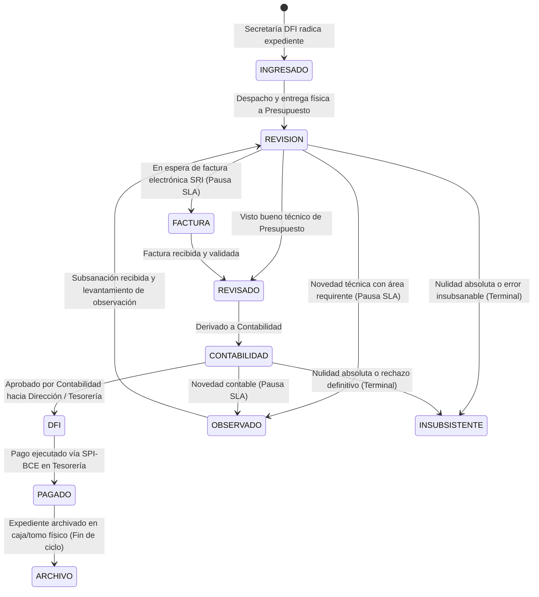

# SERVICIO NACIONAL DE ADUANA DEL ECUADOR (SENAE)
## DIRECCIÓN FINANCIERA (DFI)
# DOCUMENTO DE ESPECIFICACIÓN DE REQUERIMIENTOS DEL SISTEMA (SRS)
### Sistema de Control Previo al Pago y Gestión Integral de Expedientes (v2.0)

---

## 1. INTRODUCCIÓN Y ALCANCE GENERAL

### 1.1. Objetivo Institucional
Desarrollar e implementar un sistema web integral para la **Dirección Financiera (DFI)** del **Servicio Nacional de Aduana del Ecuador (SENAE)**, que controle de manera estricta, trazable y transparente el flujo de expedientes físicos y digitales desde su recepción en ventanilla hasta su pago definitivo en Tesorería y posterior custodia física en el Archivo Pasivo.

### 1.2. Principales Problemas que Resuelve
1. **Pérdida de trazabilidad física:** Saber con exactitud matemática qué analista o jefatura tiene físicamente cada expediente en todo momento.
2. **Vencimiento de tiempos reglamentarios (SLA):** Controlar el tiempo límite legal de **6 días laborables** para la gestión de pagos, descontando fines de semana, feriados nacionales y periodos legítimos de pausa operativa (trámites observados o pendientes de factura SRI).
3. **Control previo formal:** Garantizar el cumplimiento de las normativas de control previo al pago de la Contraloría General del Estado y el Ministerio de Economía y Finanzas (MEF).
4. **Despacho ordenado y actas de entrega:** Eliminar la entrega informal de documentos mediante generación obligatoria de **Actas de Entrega / Recepción en Excel** firmadas físicamente.

---

## 2. TAXONOMÍA Y CLASIFICACIÓN DE EXPEDIENTES

Cada trámite que ingresa al sistema pertenece a una **Categoría Padre** que condiciona las reglas de negocio, los campos obligatorios y el flujo de aprobación:

### 2.1. CATEGORÍA PADRE: TIPO PAGO
Trámites destinados a la liquidación económica y cancelación a proveedores o funcionarios:
1. **`PAGO`**: Trámite regular de pago (servicios, contratos, bienes, adquisición) con afectación presupuestaria (CUR compromiso, CUR devengado, certificación presupuestaria).
2. **`EXPEDIENTE`**: Expediente documental previo o soporte de gestiones presupuestarias.
3. **`JUSTIFICACION`**: Justificación de fondos / anticipos / viáticos que requiere conciliación y regularización contable.

### 2.2. CATEGORÍA PADRE: TIPO GARANTÍA
Trámites no comerciales de índole jurídica, afianzamiento o restitución de valores aduaneros:
1. `Caución`
2. `Devolución de caución`
3. `Devolución de valores`
4. `Garantía`
5. `Juicio`
6. `Pago indebido`
7. `Proceso coactivo`
8. `Reparación Económica`
9. `Sentencia`

---

## 3. MATRIZ DE ROLES Y RESPONSABILIDADES

| Rol Institucional | Código del Rol | Área / Departamento | Alcance de Permisos |
| :--- | :--- | :--- | :--- |
| **Secretaría DFI** | `SECRETARIA_DFI` | Recepción Ventanilla | Radicar trámites, despachar lotes iniciales a Control Previo, actas de entrega. |
| **Directora Financiera** | `DIRECTORA_FINANCIERA`| Dirección DFI | Supervisión global, autorización final de pago, reportes ejecutivos. |
| **Jefe de Presupuesto** | `JEFE_PRESUPUESTO` | Presupuesto | Recepción de lotes físicos, asignación a analistas, control de datos generales, visto bueno presupuestario. |
| **Analista de Presupuesto**| `ANALISTA_PRESUPUESTO` | Presupuesto | Control previo al pago, verificación documental, registro de CUR devengado y retenciones. |
| **Jefe de Contabilidad** | `JEFE_CONTABILIDAD` | Contabilidad | Recepción de trámites aprobados, asignación a analistas contables, aprobación contable. |
| **Analista de Contabilidad**| `ANALISTA_CONTABILIDAD`| Contabilidad | Revisión de liquidaciones, retenciones, registro de CUR contable. |
| **Tesorero / Caja** | `ANALISTA_TESORERIA` | Tesorería / Pagos | Ejecución de pago en el Banco Central (SPI-BCE), asignación de lote y comprobante de pago. |
| **Responsable de Archivo** | `RESPONSABLE_ARCHIVO` | Archivo Central | Custodia física final, asignación de caja, tomo y estantería. Cierre del expediente. |
| **Administrador** | `ADMIN` | Tecnología / Institucional | **Superusuario Universal:** Facultado para realizar absolutamente **todas las acciones de todos los roles** sin excepción (radicación, edición en cualquier etapa, reasignaciones, vistos buenos presupuestarios/contables, autorización de pago, gestión de cajas, archivo/desarchivo, anulaciones y parametrización total del sistema). |

---

## 4. CICLO DE VIDA DEL TRÁMITE (MATRIZ DE 12 ESTADOS)

### Detalle de Estados:
1. **`INGRESADO`**: Expediente recién creado por Secretaría. Permanece en "Mi Escritorio" en espera de ser despachado por lote.
2. **`REVISION`**: Expediente recibido físicamente en Presupuesto. En manos del Jefe o Analista completando control previo.
3. **`REVISADO`**: Trámite verificado y avalado con visto bueno técnico presupuestario.
4. **`FACTURA`**: Trámite con revisión presupuestaria lista pero pendiente de la emisión/recepción de factura SRI. **(Pausa el cómputo de SLA)**.
5. **`CONTABILIDAD`**: Trámite en revisión por el equipo contable.
6. **`DFI`**: Expediente en custodia de la Dirección Financiera para autorización de pago.
7. **`PAGADO`**: Pago ejecutado y verificado en Tesorería con código de referencia SPI-BCE y número de comprobante.
8. **`ARCHIVO`**: Expediente archivado físicamente con codificación de caja, tomo y estantería.
9. **`OBSERVADO`**: Estado transversal ante observaciones dirigidas a las áreas requirentes. **(Pausa el cómputo de SLA)**.
10. **`INSUBSISTENTE`**: Estado terminal por nulidad o desistimiento del trámite. Justificación inmutable.
11. **`PRESUPUESTO`**: Estado complementario para circuitos presupuestarios específicos.
12. **`JUSTIFICACION_CONTABILIDAD`**: Trámites especiales de rendición de cuentas contables.

---

## 5. REGLAS DE NEGOCIO Y CONTROL DE TIEMPOS (SLA)

1. **SLA Estándar:** Cada trámite cuenta con un plazo máximo reglamentario de **6 días laborables**.
2. **Semáforo Operativo:**
   - 🟢 **Verde (Días 1 a 3):** Gestión dentro del rango óptimo.
   - 🟡 **Amarillo (Días 4 a 5):** Alerta de vencimiento próximo.
   - 🔴 **Rojo (Día 6 o superior):** Trámite en mora o retraso crítico.
3. **Días No Laborables:** El conteo excluye fines de semana (sábados y domingos) y feriados oficiales cargados en el módulo de administración (`feriados`).
4. **Reglas de Pausa Operativa:**
   - El tiempo de SLA se detiene cuando el trámite pasa a **`FACTURA`** o **`OBSERVADO`**.
   - Los días acumulados en pausa quedan registrados en `dias_pausa_acumulados` y no afectan negativamente el indicador del analista.
5. **Exclusión Inmediata de Trámites Insubsistentes y Devueltos:**
   - En el instante en que un expediente es declarado **`INSUBSISTENTE`** o es objeto de **`DEVOLUCIÓN FORMAL`** (`DEVUELTO`), **desaparece inmediatamente del cómputo de SLA y de los semáforos activos**.
   - **Justificación:** Son trámites anulados o retornados de forma definitiva fuera de la DFI, por lo que no deben distorsionar las métricas de rendimiento ni figurar como trámites demorados.

---

## 6. ESPECIFICACIÓN DETALLADA POR FASES

---

### FASE 1: RECEPCIÓN E INGRESO EN VENTANILLA (SECRETARÍA DFI)

#### 6.1.1. Propósito Operativo
Permitir a la Secretaría de la Dirección Financiera radicar de manera rápida y sin fricción los expedientes físicos que ingresan mediante memorando formal al SENAE, estableciendo la fecha cierta de inicio del trámite.

#### 6.1.2. Clasificación del Trámite al Ingresar
- **Selector 1 (Categoría Padre):**
  - `PAGO`
  - `GARANTÍA`
- **Selector 2 (Tipo de Gestión Dependiente):**
  - Si Padre = `PAGO`: `PAGO`, `EXPEDIENTE`, `JUSTIFICACIÓN`.
  - Si Padre = `GARANTÍA`: `Caución`, `Devolución de caución`, `Devolución de valores`, `Garantía`, `Juicio`, `Pago indebido`, `Proceso coactivo`, `Reparación Económica`, `Sentencia`.

#### 6.1.3. Matriz de Campos para Categoría PAGO - PAGO
| Campo | Tipo de Dato | Obligatoriedad | Reglas y Validaciones |
| :--- | :--- | :---: | :--- |
| **Número de Quipux** | Alfanumérico | **Obligatorio (`*`)** | Debe ser único en el sistema. Identificador oficial del memorando. |
| **Fecha del Memorando** | Fecha | **Obligatorio (`*`)** | Fecha de emisión formal en Quipux. No puede ser futura. |
| **Fecha de Recepción Física** | Fecha | **Obligatorio (`*`)** | Fecha real de entrega en ventanilla DFI. Por defecto hoy. |
| **Área Requirente** | Catálogo / Selección | **Obligatorio (`*`)** | Dirección solicitante (ej: DTI, Talento Humano, Administrativa). |
| **Ciudad / Distrito** | Catálogo / Selección | **Obligatorio (`*`)** | Ubicado junto al Área Requirente. Sede o distrito de origen. |
| **Tipo de Proceso** | Selección | **Obligatorio (`*`)** | Servicios básicos, Obras, Bienes, Consultoría, etc. |
| **Asunto / Objeto del Pago** | Texto largo | **Obligatorio (`*`)** | Descripción sintética del objeto de la contratación o pago. |
| **Proveedor / Beneficiario** | Texto | **Obligatorio (`*`)** | Razón social o nombres del beneficiario del pago. |
| **RUC del Proveedor** | Numérico (13 dígitos) | **Opcional** | Si no se dispone al radicar, se deja vacío para control previo. |
| **Monto Subtotal** | Decimal monetario | **Obligatorio (`*`)** | Valor base del trámite antes de impuestos. |

#### 6.1.4. Campos y Acciones Expresamente Excluidos en Ventanilla
1. **Fojas físicas:** No se solicitan al momento del ingreso. Se cuentan y registran en etapas posteriores (Control previo / Archivo).
2. **Factura, IVA, retenciones y multas:** No se solicitan en ventanilla.
3. **Archivos digitales (PDFs):** No se adjunta ningún archivo al ingresar. El ingreso es ágil y puramente registral.

#### 6.1.5. Estado Inicial y Custodia
- **Estado asignado:** `INGRESADO`.
- **Custodio inicial:** Funcionario de Secretaría que realizó el registro.
- **Bandeja:** Aparece inmediatamente en la bandeja *"Mi Escritorio"* de Secretaría.
- **Política de Asignación:** Cero autoasignación a analistas. El trámite queda acumulado en el escritorio de secretaría a la espera de ser agrupado y despachado por lote.

---

### FASE 2: DESPACHO FÍSICO, CUSTODIA Y ASIGNACIÓN EN PRESUPUESTO (CONTROL PREVIO)

#### 6.2.1. Propósito Operativo
Normar la transferencia formal de los expedientes físicos desde la ventanilla de Secretaría DFI hacia la Jefatura de Presupuesto, garantizando que todo movimiento de documentos físicos cuente con respaldo documental (Acta de Entrega oficial) y firma de responsabilidad.

#### 6.2.2. Acciones Disponibles en la Bandeja de Secretaría ("Mi Escritorio")
1. **Pre-generación del Acta de Entrega:**
   - La Secretaria puede seleccionar $N$ trámites y presionar **«Descargar Acta de Entrega»**.
   - Genera el archivo Excel oficial para revisión, conteo previo o verificación física sin modificar el estado ni transferir la custodia todavía.
2. **Despacho y Envío a Control Previo:**
   - Al presionar **«Entregar a Control Previo»**, el sistema:
     1. Transfiere la custodia de los trámites seleccionados a la **Jefa de Presupuesto**.
     2. Mantiene el estado en **`INGRESADO`** (trámite despachado en tránsito / por recibir físicamente).
     3. Descarga automáticamente el **Acta de Entrega / Recepción en Excel** con formato institucional para firma física obligatoria.
     4. Registra el movimiento en el historial inmutable (`historial_movimientos`) indicando fecha/hora y usuario que entrega.

#### 6.2.3. Recepción Física en Presupuesto
- **Bandeja de Entrada de la Jefa de Presupuesto:** Los expedientes despachados se listan con estado `INGRESADO` en espera de recepción física.
- **Acción «Recibir Físicamente»:**
  - Una vez cotejada la documentación física y firmada el acta en papel, la Jefa de Presupuesto presiona **«Recibir Físicamente»**.
  - **Efecto de Estado:** El estado del expediente cambia automáticamente de **`INGRESADO`** a **`REVISION`**.
  - **Efecto de SLA:** Comienza formalmente el cómputo de días de control previo en el área de Presupuesto.

#### 6.2.4. Política de Asignación a Analistas de Presupuesto
- **Asignación 100% Manual por Jefatura:**
  - La Jefa de Presupuesto decide discrecionalmente a qué analista de su equipo asigna cada trámite.
  - **Cero asignación automática:** No existe reparto automático por carrusel ni algoritmos de turnos.
  - **Facultad de Trabajo Directo:** La Jefa de Presupuesto puede asumir el trámite y trabajarlo ella misma directamente (posee las facultades operativas de analista y de jefatura).
  - **Reasignación:** La Jefa puede reasignar expedientes entre analistas en cualquier momento (por carga laboral, licencias o ausencias).
- **Restricción a Analistas:**
  - Los analistas de presupuesto **no pueden auto-asignarse trámites**.
  - Solo pueden visualizar y trabajar aquellos trámites que su Jefatura les haya asignado expresamente o que estén bajo su custodia.

---

### FASE 3: CONTROL PREVIO AL PAGO EN PRESUPUESTO

#### 6.3.1. Propósito Operativo
Realizar el control previo y la verificación técnica de la legalidad del gasto y la disponibilidad presupuestaria conforme a las normas de control de la Contraloría General del Estado y del Ministerio de Economía y Finanzas (MEF).

#### 6.3.2. Facultades de Edición sobre Datos Generales
- **Permiso Pleno de Rectificación:** Toda el área de Presupuesto (**tanto la Jefa de Presupuesto como los analistas**) tiene autorización plena para editar la tarjeta de **Datos Generales** del trámite.
- **Acciones permitidas:**
  - Registrar el **RUC** del proveedor si no fue ingresado en ventanilla.
  - Corregir o precisar la Razón Social / Beneficiario, Asunto, Subtotal, Fechas o Área Requirente en caso de imprecisiones cometidas durante el ingreso inicial en ventanilla.

#### 6.3.3. Estructura de Campos Especializados de Presupuesto
| Campo | Tipo de Dato | Obligatoriedad | Descripción / Regla |
| :--- | :--- | :---: | :--- |
| **Nro / Cód Proceso** | Alfanumérico | **Obligatorio** | Código identificador del proceso de contratación o referencia técnica. Reemplaza al anterior campo "número de trámite". |
| **Certificación Presupuestaria** | Alfanumérico | **Obligatorio** | Número o código oficial de la certificación de fondos emitida. |
| **Ítem Presupuestario** | Catálogo / Selección | **Obligatorio** | Partida presupuestaria oficial (código y nombre, ej: *530204 - Edición e Impresión*). |
| **CUR Compromiso** | Alfanumérico | **Obligatorio** | Número de Comprobante Único de Registro (CUR) de compromiso generado en el sistema financiero oficial. |
| **Periodo de Pago** | Texto | **Obligatorio** | Mes, trimestre o periodo al que corresponde el devengo o pago. |
| **Factura** | Alfanumérico / Lista | Condicional | Número(s) de factura electrónica autorizada por el SRI. Si aún no existe, activa el flujo de pausa. |
| **Anexos** | Lista de textos | Opcional | Lista descriptiva de documentos habilitantes anexos (informes técnicos, actas de recepción, etc.). |

> [!IMPORTANT]
> **Campos expresamente excluidos:** En esta sección **NO se registran fojas ni hojas físicas**. El conteo de hojas se realizará en la fase de Archivo. Tampoco se utiliza el campo genérico "Número de Trámite" (sustituido definitivamente por **Nro / Cód Proceso**).

#### 6.3.4. Matriz de Aprobación Jerárquica y Regla de Continuidad de Custodia
El flujo de aprobación en Presupuesto respeta la trazabilidad del custodio original para garantizar la continuidad del expediente:

1. **Caso 1: Trámite gestionado 100% por la Jefa de Presupuesto (Sin reasignación):**
   - El trámite llega a la Jefa de Presupuesto y **nunca fue reasignado** a un analista.
   - La Jefa completa los datos presupuestarios, espera o ingresa la factura, otorga el visto bueno técnico y **ella misma despacha el trámite directamente a la Jefatura de Contabilidad**.
2. **Caso 2: Trámite reasignado a un Analista (Con retorno de custodia obligatorio):**
   - La Jefa reasigna el trámite a un analista (quien pasa a ser el custodio operativo).
   - El analista verifica la documentación, completa los datos presupuestarios (con o sin factura) y envía el trámite a la Jefa para su visto bueno formal.
   - **Regla de Continuidad:** Al presionar la Jefa el botón de aprobar visto bueno, **el sistema SIEMPRE regresa la custodia al mismo analista que lo trabajó**.
   - El analista recibe el trámite aprobado:
     - Si ya tenía factura, el analista procede a ejecutar el envío hacia la Jefatura de Contabilidad.
     - Si no tenía factura, el trámite entra en pausa **`FACTURA`** bajo su custodia; cuando la factura llega, el analista la registra y él mismo despacha a Contabilidad.
3. **Derivación a Contabilidad:**
   - En ambos casos, el pase a la Jefatura de Contabilidad es **100% digital** en plataforma (sin emisión de acta física).

#### 6.3.5. Lógica Oficial del Estado «FACTURA» y Pausa de SLA
La factura electrónica condiciona el flujo y el cómputo del tiempo de atención (SLA de 6 días):
- **Si ya cuenta con Factura:** Se ingresa directamente, se aprueba y se despacha a Contabilidad sin ingresar nunca a pausa.
- **Si NO cuenta con Factura:** Se aprueba el aspecto técnico en Presupuesto, regresa al analista custodio y entra en estado **`FACTURA`**.
- **Efecto de la Pausa:** **Congela inmediatamente el cronómetro del SLA** de 6 días reglamentarios mientras se aguarda la factura SRI.

---

### FASE 4: OBSERVACIONES (72H), DEVOLUCIÓN FORMAL Y TRÁMITES INSUBSISTENTES

#### 6.4.1. Observación Preventiva Transversal (Término Perentorio de 72 Horas)
1. **Facultad de Observación Universal:**
   - **Cualquier usuario** de cualquier departamento (Presupuesto, Contabilidad, DFI, etc.) puede observar un trámite en cualquier momento del ciclo de vida.
   - No se requiere autorización previa de ninguna jefatura para emitir una observación.
2. **Datos Requeridos al Observar:**
   - Campo obligatorio: **Motivo detallado de la observación** (descripción clara de la novedad técnica, cálculo erróneo, documento faltante o inconsistencia).
3. **Custodia Durante la Observación:**
   - El trámite permanece en custodia de la persona que emite la observación (*"yo observo, yo lo tengo"*).
4. **Estado y Pausa de SLA:**
   - El trámite adquiere el estado **`OBSERVADO`** (o `OBSERVADO_72H`).
   - El cómputo de días del **SLA reglamentario se pausa de inmediato** durante esas 72 horas para no imputar tiempos muertos a la DFI.

#### 6.4.2. Levantamiento de la Observación (Subsanación)
- **Responsable del Levantamiento:** Únicamente la **misma persona que emitió la observación** tiene la potestad de levantarla.
- **Requisito Obligatorio:** Digitar el campo **Resolución / Detalle de la Subsanación** explicando cómo fue atendida la novedad por el área requirente.
- **Efecto Operativo:**
  - El trámite retorna al **último estado operativo** en el que se encontraba antes de la observación (ej: `REVISION`, `CONTABILIDAD`).
  - **Se reanuda el cronómetro del semáforo SLA**.

#### 6.4.3. Devolución Formal del Expediente (Salida Definitiva del Flujo)
Si la observación no es subsanada en el término perentorio de 72 horas, o si el expediente presenta vicios de fondo insalvables:
1. **Procedimiento de Devolución Formal:**
   - Se activa la acción de **«Devolución Formal»**.
   - **Campos obligatorios:**
     - **Número de Memorando Quipux de Devolución** (oficio formal de retorno).
     - **Justificación legal y técnica de la devolución**.
     - **Área Destino** (área requirente a la cual se regresa la carpeta física).
2. **Efecto de Estado:**
   - El trámite adquiere el estado terminal **`DEVUELTO`**.
3. **Cierre de Ciclo:**
   - El expediente **sale definitivamente de todas las bandejas activas de la DFI**.
   - El trámite concluye de forma definitiva en el sistema por retorno al requirente.

#### 6.4.4. Trámites Insubsistentes (Anulación / Nulidad)
1. **Exclusividad Operativa de Presupuesto:**
   - **Únicamente el personal del área de Presupuesto** tiene la facultad institucional de declarar un trámite como **`INSUBSISTENTE`**.
   - Si otra área (ej: Contabilidad o Tesorería) detecta una causal de insubsistencia insalvable, debe observar el trámite o remitirlo a Presupuesto para que dicha área ejecute formalmente la declaratoria de insubsistencia.
2. **Naturaleza del Estado:**
   - Es un estado de cierre definitivo por nulidad absoluta o desistimiento del proceso.
   - Requiere obligatoriamente registrar la **Justificación de Insubsistencia**.
3. **Facultad de Reversión Excepcional:**
   - En caso de error involuntario de marcación, el trámite **puede ser revertido única y exclusivamente por el mismo funcionario que lo declaró insubsistente**.
   - Al revertirse, el sistema exige una **Justificación de Reversión** obligatoria y retorna el trámite al último estado activo previo.

#### 6.4.5. Auditoría Forense y Trazabilidad Inmutable Transversal
Todo evento ocurrido en la plataforma (asignación, reasignación, cambio de estado, visto bueno, observación, levantamiento, devolución formal, insubsistencia y reversión) se registra de manera automática e inalterable en la bitácora institucional (`historial_movimientos`), capturando:
- Fecha y hora exacta con precisión de segundos.
- Funcionario actuante (nombre, rol y área).
- Tipo de acción y comentario/justificación emitido.

---

---

### FASE 5: REVISIÓN Y APROBACIÓN CONTABLE (CONTABILIDAD)

#### 6.5.1. Propósito Operativo
Realizar la contabilización de la obligación de pago, la determinación de retenciones e impuestos aplicables y el registro de los Comprobantes Únicos de Registro (CUR) contables correspondientes.

#### 6.5.2. Llegada y Asignación de Trámites
- **Bandeja de Entrada:** Todos los trámites aprobados por Presupuesto llegan digitalmente a la custodia de la **Jefatura de Contabilidad**.
- **Facultades de Jefatura:**
  - El Jefe de Contabilidad puede trabajar el trámite de forma directa y autónoma.
  - O puede reasignarlo a un **Analista Contable** de su equipo.
- **Aprobación Jerárquica:**
  - Siempre se requiere el visto bueno formal del **Jefe de Contabilidad** (sea que él mismo trabajó el trámite o que fue elaborado y remitido por su analista).

#### 6.5.3. Campos de la Sección Contable
| Campo | Tipo de Dato | Obligatoriedad | Descripción / Regla |
| :--- | :--- | :---: | :--- |
| **CUR Devengado (CUR DEV)** | Alfanumérico / Lista | **Opcional** | Número oficial del CUR devengado registrado en el sistema financiero. Admite 0, 1 o múltiples CURs. |
| **CUR Contable (CUR CON)** | Alfanumérico / Lista | **Opcional** | Número oficial del CUR contable generado. Admite 0, 1 o múltiples CURs. |

> [!NOTE]
> **Sin campos adicionales:** El módulo contable no exige campos obligatorios restrictivos adicionales; ambos campos de CUR son opcionales para no frenar trámites especiales.

#### 6.5.4. Derivación a la Dirección Financiera
- Una vez otorgado el visto bueno del Contador General, el expediente:
  1. Cambia automáticamente al estado **`DFI`**.
  2. Transfiere su custodia a la **Directora Financiera**.
  3. Queda listo para la fase de autorización de pago.

---

### FASE 6: AUTORIZACIÓN DFI, TESORERÍA / COBRANZAS Y CORTE FORMAL DE SLA

#### 6.6.1. Autorización por la Dirección Financiera (`DFI`)
- **Acciones Disponibles para la Directora Financiera:**
  - **Autorizar Pago:** Da paso al desembolso y deriva el trámite a **Tesorería / Pagos**.
  - **Observar Trámite (72h):** Puede emitir observaciones preventivas ante inconsistencias de alto nivel.
  - **Reasignar Custodio:** Puede reasignar el expediente dentro del equipo directivo o técnico.
  - **Devolución Formal:** Puede emitir el retorno formal del trámite al área requirente con memorando Quipux.

#### 6.6.2. Roles Unificados: Tesorería y Técnico de Cobranzas
- **Equivalencia de Roles:** El **Analista de Tesorería** y el **Técnico de Cobranzas** comparten el mismo alcance operativo, perfil de permisos y facultades sobre los trámites.
- **Asignación Operativa:** El trámite llega a la bandeja de Tesorería; el Tesorero puede trabajarlo directamente o reasignarlo al Técnico de Cobranzas para su gestión compartida.

#### 6.6.3. Campos Gestionados en Tesorería / Cobranzas
| Campo | Tipo de Dato | Obligatoriedad | Descripción / Regla |
| :--- | :--- | :---: | :--- |
| **Referencia** | Alfanumérico | **Obligatorio** | Referencia de transferencia o código de lote del Banco Central del Ecuador (SPI-BCE). |
| **Número de Hojas** | Numérico entero | **Obligatorio** | **Registro oficial y definitivo del conteo de fojas físicas de la carpeta del expediente**. |
| **Fecha de Autorización de Pago** | Fecha | **Obligatorio** | Fecha en que se firma y valida internamente la orden de pago. |
| **Fecha Pago Efectivo** | Fecha | Condicional | Fecha real en la que el desembolso impacta la cuenta del proveedor/beneficiario. |

#### 6.6.4. Regla Crítica de Negocio: Corte Definitivo del Semáforo SLA
1. **Momento de Muerte del SLA:**
   - Una vez digitados los campos `Referencia`, `Número de Hojas` y `Fecha de Autorización de Pago`, el funcionario valida la autorización de pago.
   - **En este instante exacto FINALIZA FORMALMENTE EL CÓMPUTO DE LOS 6 DÍAS DE SLA**.
   - **Justificación Operativa:** La DFI ya completó el 100% de sus obligaciones normativas de control previo, devengo y emisión de pago; el tiempo posterior que tarde el Banco Central o las instituciones bancarias en acreditar los fondos en cuenta ajena no es imputable al rendimiento del personal de la DFI.
   - **Estado de Transición:** El trámite adquiere el estado **`AUTORIZADO_PAGO`** (o visto bueno de pago).
2. **Paso a Estado `PAGADO`:**
   - Cuando se confirma el débito bancario real, se registra la **Fecha Pago Efectivo** y el estado pasa a **`PAGADO`**.
   - Esta acción no reactiva ningún contador de SLA; su objetivo es completar la trazabilidad financiera y permitir el agrupamiento en Cajas para el archivo.

---

### FASE 7: GESTIÓN DE CAJAS (TESORERÍA / COBRANZAS) Y CIERRE EN ARCHIVO CENTRAL

#### 6.7.1. Creación y Empaquetado en Cajas (Exclusivo de Tesorería y Cobranzas)
- **Responsabilidad de Empaque:** La creación de cajas y asignación física de expedientes **NO se realiza en el Archivo**, se realiza en el área de **Tesorería / Cobranzas**.
- **Flujo de Empaque por Caja:**
  1. El personal de Tesorería o el Técnico de Cobranzas crea una **Caja** asignándole un código identificador único (ej: `CAJA-2026-001`).
  2. Asignan a dicha caja los trámites que se encuentren en estado **`PAGADO`**.
  3. Una vez completado el lote físico de expedientes dentro de la caja, presionan **«Cerrar Caja»** (estado `CERRADA`).
  4. El sistema genera y descarga automáticamente el **Documento Oficial de Entrega de Caja**, con la relación detallada e inventario de todos los trámites contenidos (Quipux, beneficiario, fojas, referencias).
  5. Con la caja cerrada físicamente y el documento impreso, se despacha la caja hacia el **Archivo Central**.

#### 6.7.2. Rol y Operativa del Responsable de Archivo
1. **Recepción Pasiva (Cero Carga de Datos):**
   - El personal de Archivo **no digita ningún dato** en los expedientes (todos los datos de fojas y referencias ya fueron completados en Tesorería).
   - Recibe la caja cerrada cotejada contra el documento oficial impreso.
2. **Cierre Definitivo de Trámites:**
   - Al constatar la integridad física de la caja, el custodio de Archivo presiona **«Archivar Caja»**.
   - **Efecto en Cascada:** Todos los trámites contenidos dentro de esa caja pasan automáticamente al estado terminal **`ARCHIVO`**, concluyendo su ciclo de vida institucional de manera definitiva.

#### 6.7.3. Excepciones Operativas en Archivo
1. **Devolución de Caja por Novedades:**
   - Si la caja recibida presenta inconsistencias físicas (carpetas faltantes o deterioro), el Responsable de Archivo **no puede editarla ni extraer expedientes** (por ser una caja cerrada).
   - En su lugar, presiona **«Devolver Caja»** hacia Tesorería/Cobranzas.
   - En Tesorería/Cobranzas: **abren la caja**, corrigen las novedades físicas o retiran/agregan expedientes, la vuelven a cerrar, reemiten el documento oficial y la reenvían al Archivo.
2. **Acción de «Desarchivar Trámite» (Auditoría Forense):**
   - Si con posterioridad a su archivo definitivo se requiere desarchivar un expediente (por requerimiento de Contraloría, auditoría interna, fiscalización o error involuntario):
   - El sistema permite desarchivar el trámite de forma individual.
   - **Requisito Ineludible:** Digitar una **Justificación de Desarchivo** obligatoria.
   - **Efecto:** El trámite retorna al estado previo a `ARCHIVO` (estado `PAGADO` bajo custodia de Tesorería/Cobranzas), quedando todo registrado de forma inalterable en la bitácora de auditoría.

---

---

### FASE 8: INDICADORES, SEMÁFOROS (SLA DUAL), REPORTERÍA MODULAR Y AUDITORÍA

#### 6.8.1. Modelo Dual de Medición del Tiempo (SLA vs Tiempo Global de Vida)
El sistema implementa dos métricas temporales complementarias e independientes:

1. **Métrica 1: SLA Institucional Reglamentario (Plazo Legal de 6 Días Hábiles):**
   - **Punto de Inicio Exacto:** En el instante preciso en que la **Jefa de Presupuesto marca como recibido físicamente el trámite** (cambio de estado de `INGRESADO` a **`REVISION`**).
   - **Punto de Término Exacto (Muerte del SLA):** En el instante en que Tesorería/Cobranzas registra la **`Fecha de Autorización de Pago`** (estado `AUTORIZADO_PAGO`).
   - **Días Excluidos del Conteo:**
     - Sábados y domingos.
     - Feriados oficiales nacionales y locales.
     - **Días no laborables excepcionales** configurados por el Administrador (cortes de energía, decretos de suspensión de jornada, conmoción o eventos de fuerza mayor).
     - Periodos acumulados en estado de pausa por **`FACTURA`**.
     - Periodos acumulados en estado de observación preventiva **`OBSERVADO_72H`**.
   - **Escala del Semáforo Visual:**
     - 🟢 **Verde:** 1 a 3 días hábiles efectivos (gestión óptima).
     - 🟡 **Amarillo:** 4 a 5 días hábiles efectivos (alerta preventiva de vencimiento).
     - 🔴 **Rojo:** 6 días hábiles o más (trámite en mora o retraso crítico).

2. **Métrica 2: Tiempo Global de Vida Real del Trámite (Estadística Integral):**
   - **Alcance:** Mide el tiempo cronológico absoluto total desde la radicación física inicial en ventanilla de Secretaría hasta el archivo definitivo de la caja en Archivo Central (`ARCHIVO`).
   - **Propósito:** Brindar a la Dirección Financiera y a los órganos de control una visión real de cuánto demora un trámite en el mundo real, incluyendo tiempos de espera en ventanilla, retrasos de proveedores en emitir facturas, demoras de las áreas requirentes en responder observaciones y tiempos de acreditación bancaria en el BCE.
   - **Independencia:** **Este indicador NO afecta el semáforo SLA de 6 días**, es puramente estadístico y gerencial.

#### 6.8.2. Reportería Modular, Focalizada y Útil
Se sustituye la reportería sobrecargada por herramientas directas y configurables:

1. **Reporte General de Trámites:**
   - Permite consultar y consolidar expedientes mediante filtros combinables:
     - Trámite específico (búsqueda por número Quipux, proveedor, RUC, código de proceso o referencia).
     - Por Área Requirente (DTI, Talento Humano, Administrativa, etc.).
     - Por Tipo de Proceso (Bienes, Servicios Básicos, Obras, etc.).
     - Por Estado Actual (`INGRESADO`, `REVISION`, `FACTURA`, `CONTABILIDAD`, `PAGADO`, `ARCHIVO`, etc.).
     - Por Rango de Fechas (fecha de memorando, fecha de recepción o fecha de pago).
2. **Reporte de Causas de Retrasos y Tiempos por Funcionario / Departamento:**
   - Análisis de cuellos de botella operativo:
     - Filtrable por uno o más funcionarios específicos, o por todo el equipo.
     - Filtrable por uno o más departamentos (Presupuesto, Contabilidad, Tesorería/Cobranzas, Archivo), o todos.
     - Métricas generadas: total de trámites gestionados, porcentaje resuelto dentro del plazo reglamentario vs. trámites atrasados, tiempo promedio de permanencia por etapa y detalle de motivos de observaciones y pausas.
3. **Exportación Modular y Selectiva a Excel:**
   - El sistema elimina las sábanas de datos gigantes e inmanejables.
   - El usuario puede **seleccionar expresamente qué reporte desea exportar** (ej: solo el reporte filtrado de un analista específico, solo el listado de expedientes observados, o un resumen ejecutivo consolidado).
   - El archivo Excel descargado cuenta con estructura limpia, tipografía institucional SENAE y encabezados oficiales listos para impresión o análisis en hojas de cálculo.

#### 6.8.3. Auditoría Forense y Bitácora Visual Desplegable
1. **Acceso Universal:**
   - **Todos los funcionarios del sistema** tienen permiso para visualizar la bitácora de auditoría de cualquier trámite al que tengan acceso.
2. **Diseño Visual Desplegable (Compacto vs. Detallado):**
   - Para evitar saturación visual y estrés operativo ante historiales largos:
     - **Vista Inicial (Compacta / Resumida):** Muestra los grandes hitos del trámite (Radicado, Recibido en Presupuesto, Factura, Contabilidad, Autorizado, Pagado y Archivado) con su estado y responsable principal.
     - **Vista Expandida (Detalle Atómico por Despliegue):** Al hacer clic sobre cualquier evento o presionar «Ver Bitácora Completa», se despliega el registro exhaustivo: qué acción se ejecutó, funcionario que la ejecutó (nombre y cargo), usuario destinatario que recibió la custodia, fecha y hora exacta con segundos, e historial de justificaciones, motivos de observación o resoluciones registradas.

---

## 7. ESPECIFICACIÓN INTEGRAL DE PANTALLAS Y MÓDULOS DEL SISTEMA

A continuación se detalla el comportamiento operativo de cada vista del aplicativo web:

### 7.1. Módulo de Autenticación Institucional (`/login`)
- **Acceso:** Público / Funcionario sin sesión activa.
- **Funcionalidad:**
  - Ingreso con correo institucional (`@aduana.gob.ec`) y contraseña encriptada.
  - Verificación matemática anti-automatización (Captcha 2FA).
  - Bloqueo por inactividad y persistencia segura de token de sesión.
  - Panel inferior de cambio rápido de perfil para pruebas y homologación de flujos.

### 7.2. Módulo de Recepción en Ventanilla (`/recepcion`)
- **Acceso:** Exclusivo para **Secretaría DFI**, **Directora Financiera** y **Administrador**.
- **Funcionalidad:**
  - Radicación ágil de expedientes físicos sin carga obligatoria de archivos PDF ni conteo de hojas.
  - Selectores jerárquicos dependientes: Padre (`PAGO` o `GARANTÍA`) y Tipo de Gestión.
  - Registro de Quipux único, fechas, área requirente, ciudad/distrito, tipo de proceso, asunto, beneficiario, RUC (opcional) y monto subtotal.
  - Generación del trámite en estado `INGRESADO` bajo custodia del funcionario de ventanilla.

### 7.3. Módulo "Mi Escritorio" (`/escritorio`)
- **Acceso:** Todos los usuarios autenticados (con vistas personalizadas según rol).
- **Funcionalidad:**
  - Bandeja operativa principal del funcionario: lista únicamente los expedientes que se encuentran **bajo su custodia física/digital activa**.
  - Pestañas de filtrado rápido:
    - *Trámites Asignados:* Expedientes en gestión activa.
    - *Por Recibir Físicamente:* Lotes despachados que están en tránsito hacia su área.
    - *Observados (72h):* Trámites con novedad que requieren seguimiento o subsanación.
    - *En Riesgo / Urgentes:* Trámites con semáforo SLA amarillo o rojo.
  - Selección múltiple por lote (casillas de verificación) para acciones masivas:
    - Secretaría: «Descargar Acta» y «Entregar a Control Previo» (generación automática del acta oficial de entrega en Excel).
    - Jefatura de Presupuesto: «Recibir Físicamente» (cambio a `REVISION`) y reasignación manual a analistas.

### 7.4. Módulo "Trámites" — Catálogo General (`/tramites`)
- **Acceso:** Todos los funcionarios.
- **Régimen de Permisos: MODO ESTRICTO SOLO LECTURA:**
  - **Nadie puede editar, modificar, borrar ni reasignar trámites desde esta vista**.
  - Su propósito exclusivo es la consulta, búsqueda y fiscalización institucional.
  - Buscador global por Quipux, beneficiario, RUC, código de trámite o referencia.
  - Filtros combinables por estado, área, tipo de proceso y rango de fechas.
  - Visualización del semáforo SLA y estado general de cada trámite.
  - Botón para abrir la ficha integral del expediente (que abrirá en modo lectura si el usuario no es el custodio activo del trámite).

### 7.5. Módulo Ficha Integral del Expediente (`/tramite/[id]`)
- **Acceso:** Todos los funcionarios (con permisos de edición condicionados al custodio actual y rol).
- **Estructura Modular:**
  1. **Cabecera Institucional:** Quipux, estado actual, badge de SLA, área actual y custodio actual.
  2. **Barra de Acciones Contextual:** Se adapta según el estado y rol (Visto Bueno, Derivar, Observar 72h, Levantar Observación, Insubsistente, Pausa Factura, Autorizar Pago, Cajas, Archivar, Devolver, Desarchivar).
  3. **Tarjeta de Datos Generales:** Datos de ventanilla. Editable libremente por el área de Presupuesto (Jefa y analistas) para rectificaciones y registro de RUC.
  4. **Submódulo de Referencias Quipux:** Tabla dinámica donde se pueden agregar documentos y memorandos complementarios asociados al trámite a lo largo de su vida.
  5. **Tarjeta de Presupuesto:** Nro/Cód Proceso, Certificación Presupuestaria, Ítem Presupuestario oficial, CUR Compromiso, Periodo de Pago, Factura y Anexos.
  6. **Tarjeta de Contabilidad:** CUR Devengado y CUR Contable (opcionales).
  7. **Tarjeta de Tesorería / Cobranzas:** Referencia SPI-BCE, Número de Hojas (conteo definitivo), Fecha de Autorización de Pago (fin de SLA) y Fecha Pago Efectivo.
  8. **Tarjeta de Cajas y Archivo:** Código de caja, cierre de lote con documento impreso y estado final de archivo.
  9. **Línea de Tiempo / Bitácora:** Desplegable e interactiva para trazabilidad completa.

### 7.6. Módulo Unificado de Reportes e Indicadores de Gestión (`/reportes`)
- **Acceso:** Todos los funcionarios (con vistas ejecutivas para Jefaturas y Dirección).
- **Consolidación de Módulos:** Se unifica la antigua pantalla independiente `/indicadores` dentro de `/reportes` para evitar dispersión visual y centralizar todas las métricas en un único punto.
- **Estructura y Pestañas:**
  1. **Tablero de Control de Indicadores (Dashboard SLA):**
     - Semáforo oficial de 6 días laborables (Verde / Amarillo / Rojo).
     - Tarjetas de KPIs principales: Total registrados, en flujo activo, en espera de factura, observados (72h), autorizados a tiempo y trámites en mora.
     - Gráficos ejecutivos de volumen por área requirente y tiempo promedio por departamento.
     - Métrica paralela de Tiempo Global de Vida Real.
  2. **Reporte General de Trámites:**
     - Buscador y filtros dinámicos combinables (por trámite, área requirente, proceso, estado y rango de fechas).
  3. **Reporte de Causas de Retrasos y Rendimiento:**
     - Métricas por analista o departamento, identificando cuellos de botella y motivos de observación/pausa.
  4. **Exportador Modular y Selectivo a Excel:**
     - Descarga personalizada donde el usuario selecciona exactamente qué reporte o sección desea exportar sin sábanas innecesarias de datos.

### 7.7. Módulo de Administración del Sistema (`/administracion`)
- **Acceso: Exclusivo para Administrador del Sistema (`ADMIN`).**
- **Secciones de Configuración:**
  1. **Usuarios:** Creación, edición, reseteo de claves, asignación de rol, área institucional y estado de disponibilidad (`DISPONIBLE` / `NO DISPONIBLE`).
  2. **Feriados y Días No Laborables:** Calendario de días no laborables oficiales y excepcionales que descuentan tiempo al SLA de 6 días.
  3. **Catálogo de Procesos y Áreas:** Gestión de tipos de trámite, partidas presupuestarias institucionales y áreas requirentes.
  4. **Campos Dinámicos y Reglas de Flujo:** Configuración de visibilidad y obligatoriedad de campos por departamento.
  5. **Auditoría Global:** Visor central de toda la bitácora transaccional del sistema.

---

---

## 9. MÓDULO DE MIGRACIÓN E IMPORTACIÓN DE BITÁCORAS EXCEL (LEGACY)

#### 9.1. Propósito Institucional de la Migración
Permitir a la Dirección Financiera (DFI) migrar de forma masiva, controlada y sin pérdida de datos los expedientes históricos registrados previamente en archivos de hojas de cálculo Excel (bitácoras 2026, 2019, etc.), consolidando toda la memoria institucional dentro de la base de datos relacional del nuevo sistema web.

#### 9.2. Análisis Forense de la Base 2026 (`Enero-Junio-2026.xlsx`)
El análisis técnico del archivo oficial arrojó la existencia de **1.634 trámites históricos reales** estructurados en dos hojas operativas:
1. **Hoja `PAGO`:** **1.097 expedientes reales** (25 columnas de datos, fila 4 contiene encabezados, datos útiles de fila 5 a 1.101).
2. **Hoja `GARANTÍA`:** **537 expedientes reales** (19 columnas de datos, fila 3 contiene encabezados, datos útiles de fila 4 a 540).

#### 9.3. Matriz de Homologación de Columnas (Excel vs. Base de Datos)

##### A. Hoja `PAGO` (Categoría Padre: PAGO)
| Columna en Excel | Tipo Dato en Excel | Campo en Sistema SENAE | Regla de Transformación |
| :--- | :--- | :--- | :--- |
| **Col 1: Nº** | Numérico | `nro_tramite` | Correlativo del trámite. |
| **Col 2: TIPO** | Texto (`PAGO`, `Expediente`, `Justificación`) | `padre_gestion` = `PAGO` `tipo_gestion` = valor normalizado | Si dice "Archivo", se clasifica como tipo expediente archivado. |
| **Col 3: CIUDAD** | Texto (`GUAYAQUIL`, `CUENCA`, etc.) | `ciudad` | Sede o distrito de origen. |
| **Col 4: MEMORANDO** | Alfanumérico (ej: `SENAE-CDGU-2026-0007-M\n...`) | `numero_quipux` + `tramite_referencias` | El primer Quipux se asigna como principal; si la celda tiene saltos de línea con memorandos adicionales, se crean filas hijas en `tramite_referencias`. |
| **Col 5: FECHA RECEPCIÓN** | Fecha ISO | `fecha_recepcion_fisica` | Fecha de ingreso a ventanilla. |
| **Col 6: FECHA ENTREGA AL ANALISTA** | Fecha ISO | `fecha_entrega_control_previo` | Fecha de pase a revisión. |
| **Col 7: TIPO CONTRATACIÓN** | Texto (`Servicios Básicos`, `Contrato`, etc.) | `id_tipo_tramite` | Homologación automática contra el catálogo de procesos. |
| **Col 8: CONTRATO** | Alfanumérico (`014-2025`, `IC-SENAE-2025-024`) | `nro_proceso` | Código del proceso o contrato. |
| **Col 9: CERTIFICACIÓN PRESUPUESTARIA** | Alfanumérico (`57`, `615`, `2`) | `certificacion_presupuestaria` | Certificación oficial de fondos. |
| **Col 10: ITEM** | Alfanumérico (`530104`, `530502`) | `item_presupuestario` | Partida presupuestaria. |
| **Col 11: DESCRIPCIÓN** | Texto largo | `asunto` | Objeto del pago / contratación. |
| **Col 12: RUC** | Numérico (13 dígitos) | `ruc_proveedor` | Se importa si existe; si está vacío se mantiene nulo (opcional). |
| **Col 13: PROVEEDOR/ BENEFICIARIO** | Texto | `proveedor_beneficiario` | Razón social del contratista o beneficiario. |
| **Col 14: PERIODO** | Texto (`27-11-2025 al 27-12-2025`) | `periodo_pago` | Periodo liquidado. |
| **Col 15: FACT.** | Texto (`varias facturas`, códigos SRI) | `numero_factura` | Identificador de factura. |
| **Col 16: VALOR** | Decimal | `monto_total` / `subtotal` | Monto del trámite. |
| **Col 17: CUR DEV** | Alfanumérico (`189-199`) | `numero_cur_devengado` | Número oficial de CUR devengado. |
| **Col 18: FECHA RECIBE JCO** | Fecha | `fecha_aprobacion_presupuesto` | Fecha de pase a Contabilidad. |
| **Col 20: FECHA DE PAGO** | Fecha | `fecha_pago` | Fecha de pago efectiva. |
| **Col 21: ANALISTA DE PRESUPUESTO** | Iniciales (`RG`, `DB`, `MS`, `NM`, etc.) | `id_custodio_actual` | Mapeo mediante diccionario institucional de analistas. |
| **Col 22: ESTADO DEL TRÁMITE** | Texto (`DFI`, `Archivo`, `Contabilidad`, etc.) | `estado_general` | Mapeo directo contra los estados del sistema. |
| **Col 23: NOVEDADES** | Texto | `motivo_observacion` | Detalle de observación histórica. |
| **Col 24-25: FECHA DEVOLUCIÓN / No. MEMORANDO** | Fecha y Quipux | `observaciones` | Registro de devolución formal histórica. |

##### B. Hoja `GARANTÍA` (Categoría Padre: GARANTIA)
| Columna en Excel | Tipo Dato en Excel | Campo en Sistema SENAE | Regla de Transformación |
| :--- | :--- | :--- | :--- |
| **Col 1: Nro.** | Numérico | `nro_tramite` | Correlativo del trámite. |
| **Col 2: TIPO PAGO** | Texto (`Garantía`, `Devolución de caución`, `Juicio`, etc.) | `padre_gestion` = `GARANTIA` `tipo_gestion` = valor | Homologación con catálogo de Garantías. |
| **Col 3: DIRECCIÓN** | Texto (`Guayaquil`, `Manta`, `Cuenca`) | `ciudad` / `area_requirente` | Dirección distrital de origen. |
| **Col 4: MEMORANDO** | Alfanumérico (con saltos de línea) | `numero_quipux` + `tramite_referencias` | Primer Quipux principal, subsiguientes como referencias. |
| **Col 5-6: FECHAS INGRESO / ENTREGA** | Fechas | `fecha_recepcion_fisica` / `fecha_entrega_control_previo` | Tiempos de ventanilla y control previo. |
| **Col 7: DESCRIPCIÓN** | Texto largo | `asunto` | Asunto del trámite de garantía. |
| **Col 8: Nro. LIQUIDACIÓN** | Alfanumérico (`50182421`, `42499484`) | `numero_liquidacion` | Número oficial de liquidación aduanera. |
| **Col 9: BENEFICIARIO** | Texto | `proveedor_beneficiario` | Nombre del beneficiario o accionante. |
| **Col 10: VALOR** | Decimal | `monto_total` | Valor de la garantía o caución. |
| **Col 11: CUR CONTABLE** | Alfanumérico (`123143777`) | `numero_cur_contable` | CUR de registro contable. |
| **Col 12: FECHA RECIBE JCO** | Fecha | `fecha_aprobacion_presupuesto` | Fecha recepción contabilidad. |
| **Col 14: FECHA DE SOL. PAGO** | Fecha | `fecha_autorizacion_pago` | Fecha autorización de desembolso. |
| **Col 15: SERVIDOR DE PRESUPUESTO** | Iniciales (`RG`, `MR`, `HA`, etc.) | `id_custodio_actual` | Mapeo de custodio analista. |
| **Col 16: ESTADO** | Texto (`DFI`, `Archivo`, `Devuelto`, etc.) | `estado_general` | Mapeo de estado oficial. |
| **Col 17-19: NOVEDADES / DEVOLUCIÓN** | Textos y memorando | `motivo_observacion` / `observaciones` | Observación y memorando de retorno. |

#### 9.4. Reglas Técnicas de Transformación y Sanitización
1. **Tratamiento de Múltiples Quipux por Celda:**
   - Si la celda de memorando contiene saltos de línea `\n`, el parser extrae cada línea limpia (`trim()`).
   - El primer código se asigna al campo único `numero_quipux`.
   - Los demás códigos se crean automáticamente en la tabla vinculada `tramite_referencias` con tipo `REFERENCIA_QUIPUX_ANEXO`.
2. **Diccionario de Iniciales de Analistas:**
   - El parser utiliza un mapa de equivalencias para asociar iniciales (`RG`, `DB`, `MS`, `NM`, `MR`, `HA`, `JM`, `ID`) con los IDs de usuario del sistema.
   - En casos de iniciales compuestas (`MS/NM`), se asigna al primer titular como custodio y se anota la co-responsabilidad en la bitácora inicial.
3. **Inmunidad de Estados Históricos en el SLA:**
   - Trámites importados con estado `Archivo` o `Devuelto` se marcan como inactivos de forma definitiva, **sin disparar alertas ni semáforos de SLA vencidos**.
4. **Idempotencia y Prevención de Duplicados:**
   - La migración verifica la existencia previa de cada `numero_quipux`. Si el trámite ya existe en la base de datos, el importador puede omitirlo o actualizar sus campos sin generar duplicados.

#### 9.5. Flujo de Usuario (UX) de la Importación en la Interfaz Web
- **Ubicación:** Pestaña **«Migración de Datos»** en el módulo de Administración (`/administracion`), accesible únicamente para el rol `ADMIN`.
- **Pasos del Proceso:**
  1. **Selección / Carga:** El Administrador sube el archivo Excel (o ejecuta la importación directa de la ruta institucional de red/local).
  2. **Análisis Previo (Pre-Flight Preview):** El sistema procesa el archivo en memoria y muestra un cuadro resumen:
     - Total detectados en Hoja `PAGO`: 1.097
     - Total detectados en Hoja `GARANTÍA`: 537
     - Registros nuevos a crear vs. Trámites ya existentes.
  3. **Confirmación Transaccional:** El Administrador presiona **«Confirmar Migración Masiva»**. El sistema realiza la inserción en bloques mediante transacciones seguras (`prisma.$transaction`).
  4. **Informe de Resultados:** Muestra el número exacto de registros migrados exitosamente, advertencias de filas omitidas y un acceso directo para consultar los expedientes migrados en el Catálogo de Trámites.

---

## 10. MATRIZ DE REQUERIMIENTOS CONSOLIDADOS (ESTADO FINAL INTEGRAL)

| Fase / Módulo del Sistema | Estado de Definición | Reglas Principales Incorporadas |
| :--- | :---: | :--- |
| **1. Ventanilla DFI** | **100% Definida** | Quipux único, ciudad, subtotal, RUC opcional, sin fojas ni PDFs al ingresar. |
| **2. Despacho y Asignación** | **100% Definida** | Acta Excel obligatoria, entrega a Jefa de Presupuesto, recepción física (`REVISION`), asignación 100% manual por Jefatura sin autoasignación a analistas. |
| **3. Control Previo (Presupuesto)** | **100% Definida** | Rectificación plena de datos generales, campos presupuestarios oficiales (Nro/Cód Proceso, ítem, CUR compromiso), visto bueno de Jefa y regla de continuidad de retorno al analista para envío a contabilidad. |
| **4. Observaciones y Devolución** | **100% Definida** | Observación universal con plazo de 72h y pausa de SLA, subsanación por el mismo usuario, devolución formal con Quipux (`DEVUELTO`), insubsistencia exclusiva de Presupuesto y reversible excepcionalmente. Insubsistentes y devueltos desaparecen del SLA. |
| **5. Contabilidad** | **100% Definida** | Llegada a Jefatura de Contabilidad, visto bueno formal de jefatura, CUR DEV y CUR CON opcionales, derivación digital a DFI. |
| **6. Autorización y Tesorería** | **100% Definida** | Directora Financiera autoriza o devuelve. Roles equivalentes de Tesorería y Cobranzas. Registro de Referencia, Número de Hojas (oficial) y Fecha Autorización. **Muerte formal de SLA al autorizar el pago**. Registro posterior de Fecha Pago Efectivo (`PAGADO`). |
| **7. Cajas y Archivo Central** | **100% Definida** | Cajas creadas, cerradas y con documento emitido en Tesorería/Cobranzas. Archivo no digita: archiva caja completa o la devuelve si hay novedades. Desarchivo con justificación inmutable. |
| **8. Reportes e Indicadores Unificados** | **100% Definida** | SLA 6 días (desde `REVISION` hasta `AUTORIZADO_PAGO`) vs. Tiempo Global. Indicadores integrados dentro de `/reportes`. Filtros modulares, exportación selectiva a Excel, auditoría desplegable, `/tramites` en solo lectura y superusuario `ADMIN` con facultades universales. |
| **9. Migración de Bitácoras Legacy** | **100% Definida** | Importación masiva desde Excel 2026 (1.097 Pagos, 537 Garantías, 1.634 totales), mapeo columna por columna, división de memorandos múltiples en referencias y deduplicación por Quipux. |

